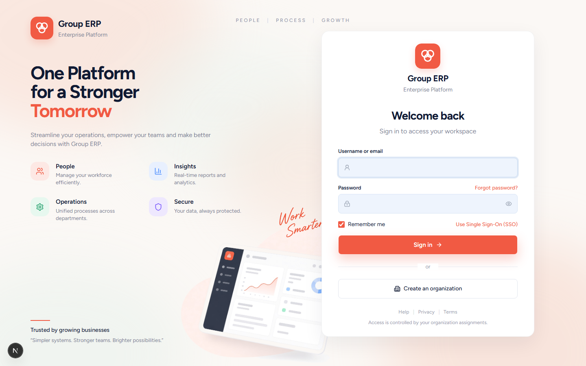
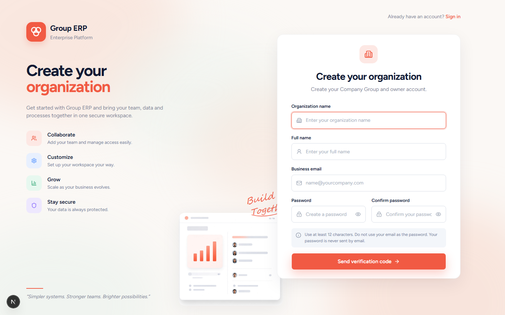
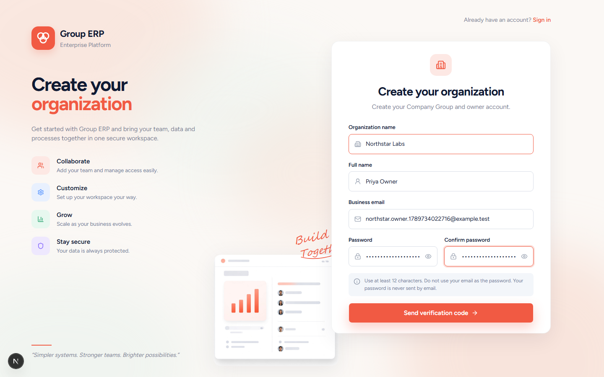
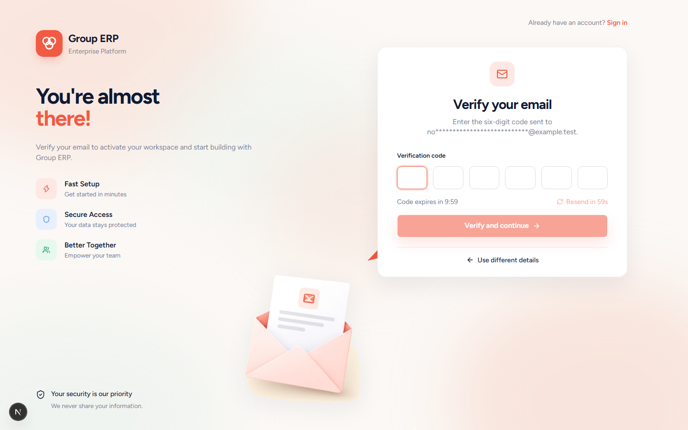
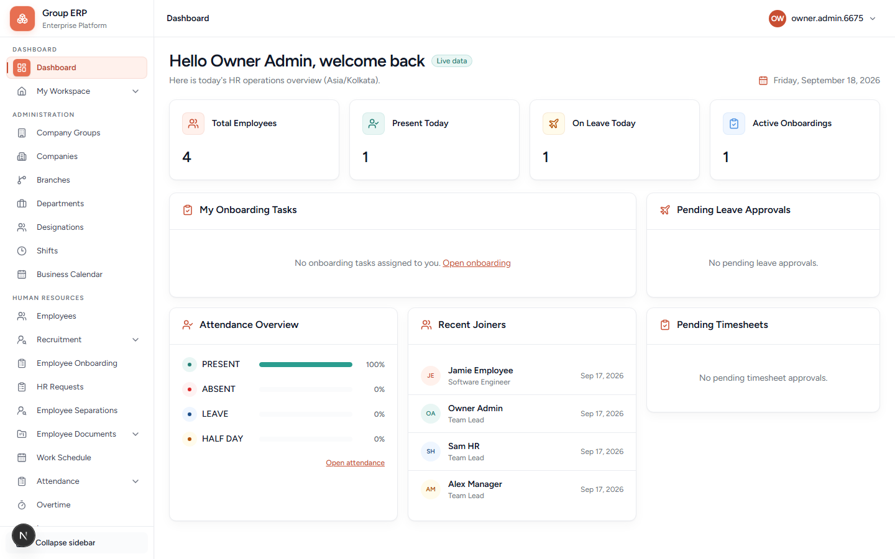

# 01 — Register and first setup

**Why this exists:** This is how a new customer gets a blank company of their own. After this chapter you are Organization Owner of **Northstar Labs** (or your real name).

**Who:** You (future Organization Owner). Nobody else exists yet.

**Where:** http://localhost:3200/login then **Create an organization**, or open http://localhost:3200/register directly.

---

## What you will create

```text
Login → Create an organization
     → Fill name, your name, email, password
     → Email verification code
     → Setup hub (/onboarding)
     → Confirm main branch
     → Add first department
     → Open my workspace (/dashboard)
```

Registration already creates:

- the **Company Group** (organization)
- the first **Company**
- your **Owner** login

The hub then forces a **Branch** and a **Department** before you can open the workspace. Designation and Shift are optional on the hub (add them in chapter 02 if you skip them here).

---

## Screen: Login



### Options on this page

| Option | What it is for |
|--------|----------------|
| **Username or email** | The login you already have. Empty on first day. |
| **Password** | Your login password. |
| **Forgot password?** | Sends a reset link to the email. Use only after you have an account. |
| **Show / hide password** (eye icon) | Lets you check what you typed. |
| **Remember me** | Stores the username in this browser. Does **not** store the password. |
| **Use Single Sign-On (SSO)** | Not enabled in this product yet. Shows a message if you click it. Ignore for Northstar. |
| **Sign in** | Enters the app if the account exists. |
| **Create an organization** | **Start here** when you have no company yet. Hidden if self-registration is turned off in the environment. |

**Do this:** Click **Create an organization**.

---

## Screen: Create your organization





### Fields

| Field | Required? | What it is for | Northstar value |
|-------|-----------|----------------|-----------------|
| **Organization name** | Yes | Name of your Company Group. This is the customer/tenant name. | `Northstar Labs` |
| **Full name** | Yes | Your name as Owner. | `Priya Owner` |
| **Business email** | Yes | Login email. OTP is sent here. Use an inbox you can read, or a local `example.test` address if development shows the code on screen. | your email |
| **Password** | Yes | Owner login from now on. Minimum **12** characters. Must **not** be the same as the email. | write in notepad |
| **Confirm password** | Yes | Must match Password. | same as password |
| **Send verification code** | — | Creates a pending registration and sends (or shows) a 6-digit code. Does not finish setup yet. |

The grey info box is a reminder: long password, never emailed to you.

**Do this:**

1. Type the Northstar values.
2. Choose a password of 12+ characters. Write it in your notepad.
3. Click **Send verification code**.

**Pass when:** You reach the six-box verification screen.

**If it fails**

| Message / symptom | What to do |
|-------------------|------------|
| Create an organization is missing | Self-registration or mail is off. Ask whoever runs the environment, or use Super Admin to create a Company Group (fallback only). |
| Account already exists | That email is taken. Use a new email. |
| Password too short | Use 12 characters or more. |
| Passwords do not match | Re-type confirm. |

---

## Screen: Verify your email



### Options

| Option | What it is for |
|--------|----------------|
| **Six digit boxes** | The code from email (or, in local development, a code the app may show on the page). |
| **Code expires in …** | You must verify before this timer hits zero. |
| **Resend code** | Sends a new code. The old one stops working. There is a short cooldown. |
| **Verify and continue** | Creates the Company Group, first Company, Owner role, and signed-in session. |
| **Use different details** | Goes back to the form if you typed the wrong email. |

Local development may show a “Development verification code” box. **Do not** copy that code into git or screenshots you share. On a real customer site the code only arrives by email.

**Do this:** Enter the 6 digits → **Verify and continue**.

**Pass when:** The browser opens `/onboarding` (the setup hub).

---

## Screen: Organization setup hub

This is **not** employee onboarding (joining a new hire). This hub only finishes the **company skeleton**. After verification you land on `/onboarding`.

(The hub screenshot is not in this folder yet — local registration did not always return a development verification code. The layout below matches the live page.)

The hub has three bands:

| Band | Meaning |
|------|---------|
| **Already set up (from your registration)** | Organization name, Owner account, Company profile. You can **Edit** organization or company name / tax later. |
| **Finish these items** | Required: **Confirm your main branch**, **Add your first department**. |
| **Set up later (optional)** | Invite team (do this in Users after the hub), Designations, Shifts, Tax number. |

### Right side — Workspace summary

Checklist of what is done. **Open my workspace** stays disabled until Branch + Department exist.

If you leave and sign in again before finishing, the app sends you back here until setup is complete.

---

## Confirm your main branch

1. Click **Confirm branch**.
2. Fill the dialog (branch name, optional address, city, country code).

| Field | Required? | What it is for | Northstar value |
|-------|-----------|----------------|-----------------|
| **Branch name** | Yes | Office people will see. | `Kochi Head Office` |
| **Address line 1** | No | Street address. | `42 Infopark Road` |
| **City** | No | City. | `Kochi` |
| **Country code** | No | Two letters (ISO). Default on this dialog is often `AE`. Change it if you are in India. | `IN` |
| **Save branch** | — | Creates the branch. Code (`BR-…`) is generated. | |
| **Cancel** | — | Close without saving. | |

**This dialog does not ask for timezone.** That is normal. After you open the workspace, set timezone under **Administration → Branches → Edit** (chapter 02). Without timezone, attendance and leave days can be wrong.

**Pass when:** The branch card shows **Completed**.

---

## Add your first department

1. Click **Add department** (enabled only after a branch exists).
2. You can click a suggestion chip: Operations, Administration, Sales, General — or type your own.

| Field | Required? | What it is for | Northstar value |
|-------|-----------|----------------|-----------------|
| **Department name** | Yes | First team. You can add more later. | `Human Resources` |
| Suggestion chips | No | Fast fill. They only set the name. | optional |
| **Save department** | — | Creates the department under the first branch. | |

**Pass when:** Department card shows **Completed**.

---

## Optional cards on the hub (you can skip)

| Card | What it is for | Do it now? |
|------|----------------|------------|
| **Invite your team later** | Explains that Users come after the workspace. Not a button. | Skip |
| **Designations** | Job titles. | Nice to add `Staff` now, or wait for chapter 02 |
| **Shifts** | Working hours for attendance. | Nice to add `Day Shift` now, or wait for chapter 02 |
| **Tax information** | Company tax / GST style number. | Optional |

---

## Open the workspace

1. Confirm the right-hand checklist: organization, company, branch, department done.
2. Click **Open my workspace**.
3. You land on **Dashboard** (`/dashboard`).



**Pass when:** Left menu shows Administration and Human Resources (Owner). You are no longer sent back to `/onboarding`.

---

## What exists now vs still missing

| Exists | Still missing (next chapters) |
|--------|-------------------------------|
| Company Group, Company, Branch, 1 Department, Owner login | Timezone on the branch |
| | More departments, designations, shift |
| | Employees other than (maybe) the owner profile |
| | HR / Manager / Employee logins |
| | Calendar, leave, attendance |

---

## Next

[02 — Company structure](./02-company-structure.md) — add timezone, extra departments, designations, and a default shift.
