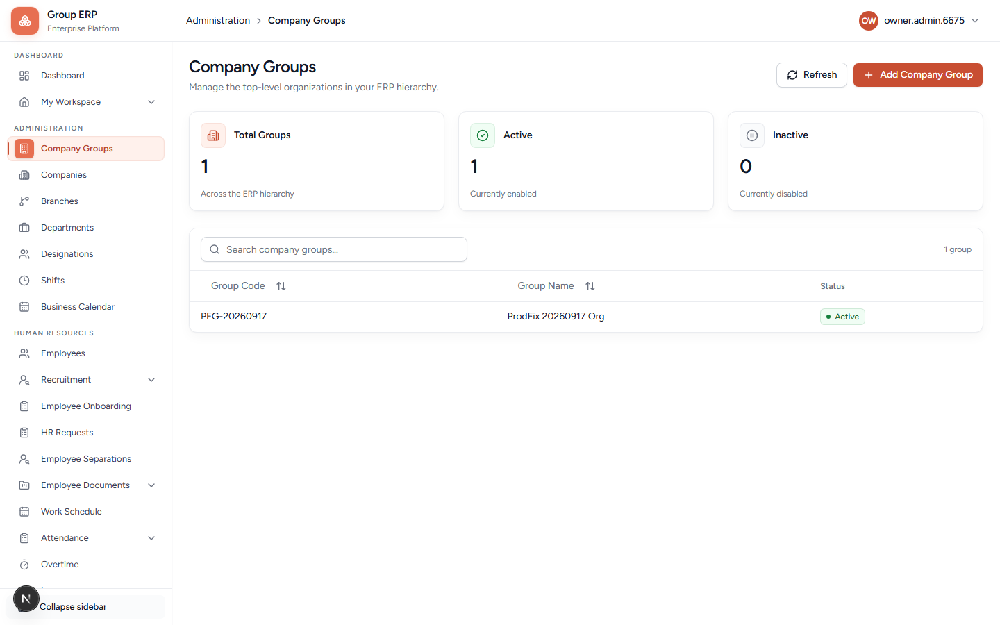
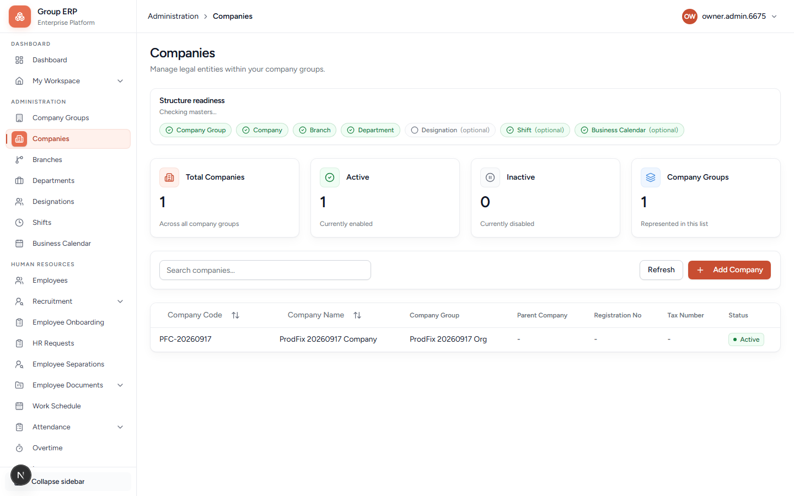
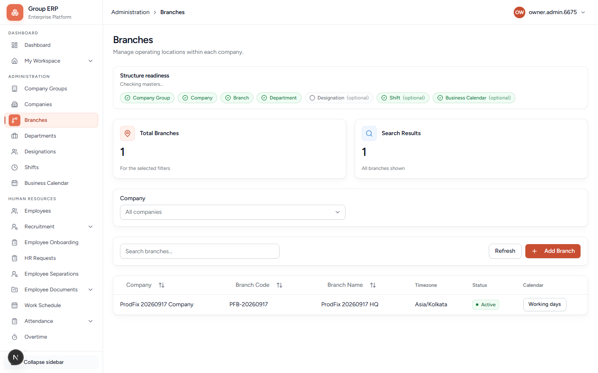
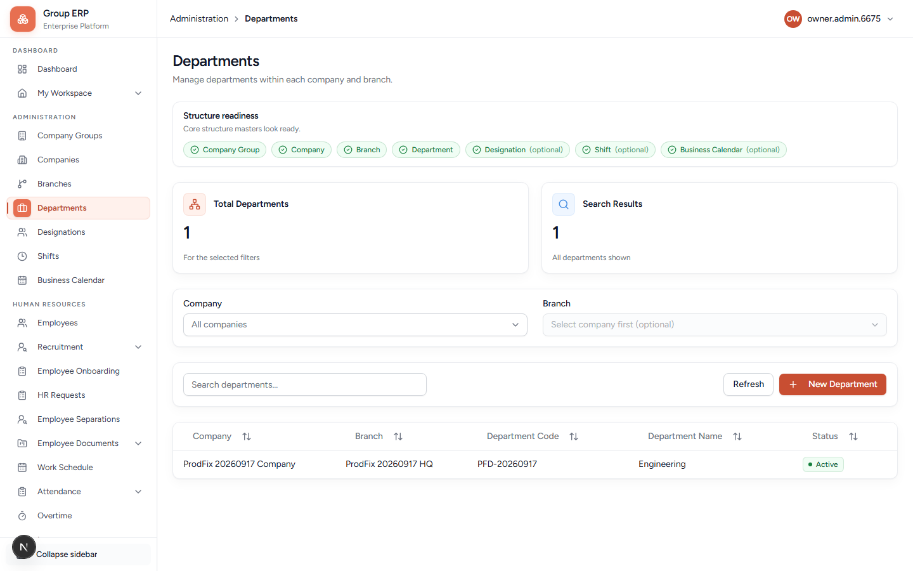
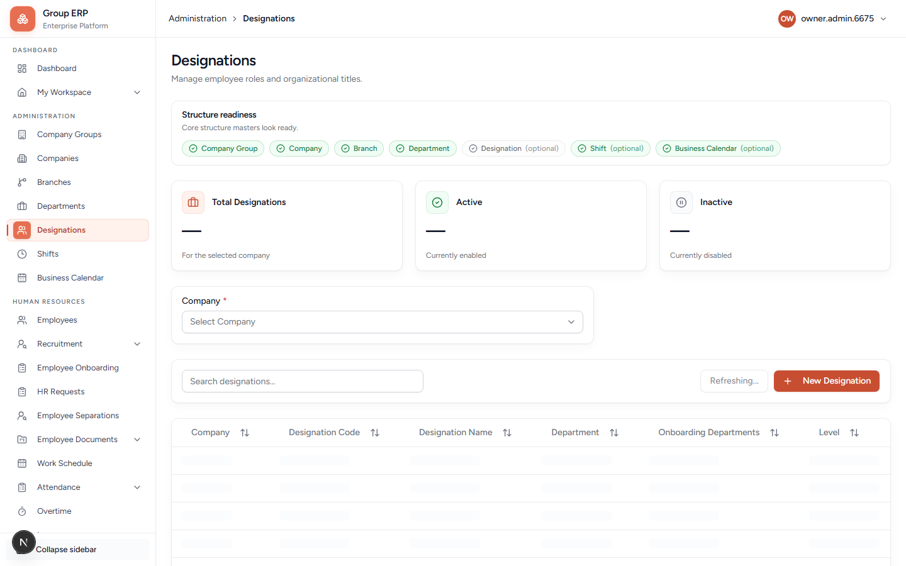
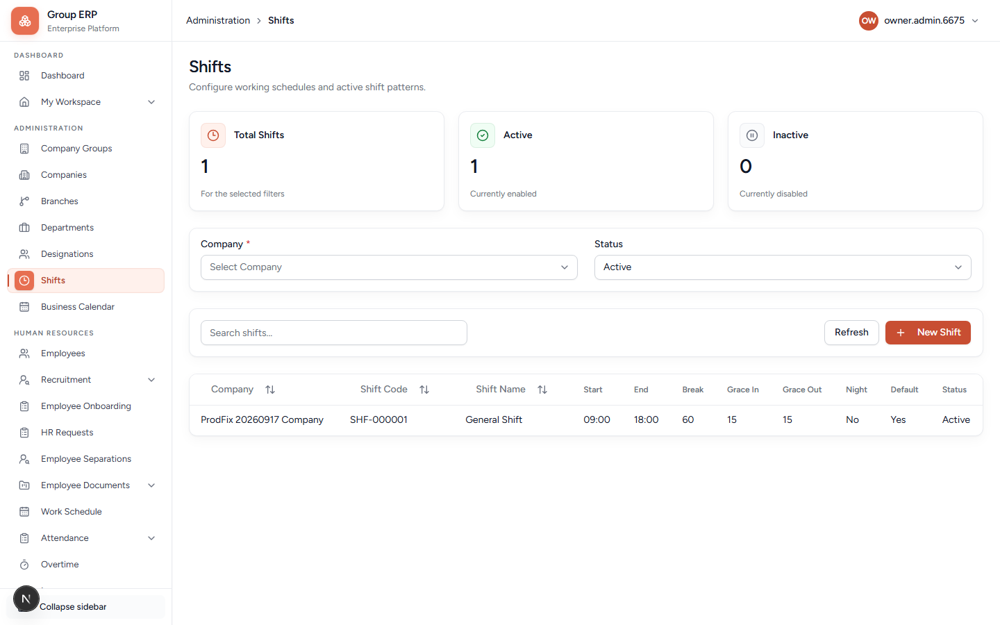
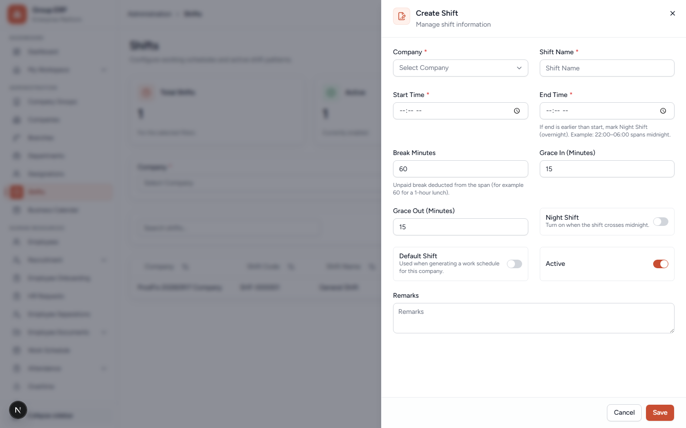

# 02 — Company structure

**Why this exists:** Everything else hangs off this skeleton. Leave, attendance, recruitment, and assets all need Company → Branch → Department. Designations feed leave and onboarding. Shifts feed attendance.

**Who:** Organization Owner (Priya).

**Where:** Left menu **Administration**.

Stay on **Northstar Labs Pvt Ltd** in every dropdown. Ignore other companies if the shared local database lists them.

---

## Order (do not skip)

```text
Company Group (already exists)
    → Company (already exists; you may add another)
        → Branch (exists; now set timezone)
            → Department (add Engineering, Finance, …)
        → Designation (job titles on the company)
        → Shift (working hours on the company)
```

A department always belongs to **one branch**. A designation belongs to **one company**. A shift belongs to **one company**.

---

## 2.1 Company Groups

**Menu:** Administration → Company Groups
**URL:** `/administration/company-groups`



| You see | Meaning |
|---------|---------|
| Group name | Northstar Labs |
| Group code | Generated. Display only. |
| Active | If off, the group is not usable. Leave **on**. |

You rarely create a second group. Registration already made yours. Creating another group is a **different customer**, not a second office.

---

## 2.2 Companies

**Menu:** Administration → Companies
**URL:** `/administration/companies`



Click **Add Company** only if you need a second legal entity. For Northstar, edit the existing company if the name should be `Northstar Labs Pvt Ltd`.

Use the orange button. Do not paste `/administration/companies/new` into the address bar in local dev — a full refresh of `/new` can 404. The button opens the form.

Field table for the create/edit form:

| Field | Required? | What it is for | Northstar |
|-------|-----------|----------------|-----------|
| **Company Group** | Yes | Which organization this legal entity belongs to. | Northstar Labs |
| **Parent Company** | No | Only if this entity sits under another company (holding / subsidiary). First company: leave empty if the control allows. | none |
| **Company Name** | Yes | Legal name people will see. | `Northstar Labs Pvt Ltd` |
| **Registration Number** | No | Company registration / CIN style number. | optional |
| **Tax Number** | No | GST / tax id. Same idea as the hub “Tax information” card. | optional |
| **Active** | — | Off = hidden from new work. Keep on. | on |

**Pass when:** Your company shows in the list with a generated `COM-…` code. Write the code in your notepad.

---

## 2.3 Branches (set timezone here)

**Menu:** Administration → Branches
**URL:** `/administration/branches`



The hub created **Kochi Head Office**. Open **Edit** on that row.

### New branch (click **Add Branch**)

The form fields:

| Field | Required? | What it is for | Northstar |
|-------|-----------|----------------|-----------|
| **Company** | Yes | Legal entity this office belongs to. | Northstar Labs Pvt Ltd |
| **Branch Name** | Yes | Office name. | `Kochi Head Office` (or `Bengaluru Delivery` if adding a second office) |
| **Address Line 1 / 2** | No | Street. | optional |
| **City / State / Postal Code** | No | Address. | Kochi / Kerala / optional |
| **Country Code** | No | Two letters. | `IN` |
| **Timezone** | Strongly recommended | Used for punch time, calendar days, leave duration. Example `Asia/Kolkata`. Empty timezone causes wrong “today”. | `Asia/Kolkata` |
| **Active** | — | Keep on. | on |

**Do this now:** Edit Kochi Head Office → set **Timezone** to `Asia/Kolkata` → Save.

**Pass when:** The branch shows; timezone is filled.

Add a second branch only if you truly have two offices. Each branch needs its own departments.

---

## 2.4 Departments

**Menu:** Administration → Departments
**URL:** `/administration/departments`



You already have **Human Resources**. Add **Engineering** and **Finance** so later onboarding / assets have somewhere to live.

### New department (click **New Department**)

The form fields:

| Field | Required? | What it is for | Northstar |
|-------|-----------|----------------|-----------|
| **Company** | Yes | Pick first. Branch list fills after this. | Northstar Labs Pvt Ltd |
| **Branch** | Yes | Office this team sits in. Disabled until company is chosen. | Kochi Head Office |
| **Department Name** | Yes | Team name. Unique per branch. | `Engineering`, then `Finance` |
| **Active** | — | Keep on. | on |

**Pass when:** HR, Engineering, and Finance exist on Kochi Head Office.

---

## 2.5 Designations (job titles)

**Menu:** Administration → Designations
**URL:** `/administration/designations`



### New designation (click **New Designation**)

The form fields:

| Field | Required? | What it is for | Northstar |
|-------|-----------|----------------|-----------|
| **Company** | Yes | Job titles are per company. Locked after save. | Northstar Labs Pvt Ltd |
| **Designation Name** | Yes | Title on the employee record and leave matrix row. | `Staff` first, then `Team Lead`, `HR Manager` |
| **Level** | No | Number for sorting / seniority. Example 1 = junior, 3 = manager. | optional |
| **Belongs to Department** | No | Home department on the org chart. **Not** the same as onboarding involvement below. | Engineering for Team Lead; Human Resources for HR Manager |
| **Active** | — | Off designations cannot get new onboarding department links. | on |
| **Branch (for onboarding)** | No | Only if you have onboarding permission. Which branch’s departments can be ticked for joining checklists. | Kochi Head Office |
| **Onboarding Involvement Departments** | No | Which departments will have tasks when someone with this title is onboarded (IT laptop, HR papers, …). Tick departments; do **not** pick a named person. | HR + Engineering + Finance for Staff |

If **Onboarding Involvement** is missing, the Onboarding module flag is off or you lack `hr.onboarding.manage`. You can still save the title and use it for leave.

Create at least **Staff**. Leave policy has one row per designation.

**Pass when:** `Staff` exists on Northstar Labs Pvt Ltd.

---

## 2.6 Shifts

**Menu:** Administration → Shifts
**URL:** `/administration/shifts`



Without a shift, Work Schedule generation often creates **zero** rows and employees cannot punch.

### New shift (click **New Shift**)



| Field | Required? | What it is for | Northstar |
|-------|-----------|----------------|-----------|
| **Company** | Yes | Shift belongs to this company. | Northstar Labs Pvt Ltd |
| **Shift Name** | Yes | Label on the roster. | `Day Shift` |
| **Start Time** | Yes | Clock-in expected. | `09:00` |
| **End Time** | Yes | Clock-out expected. If this is *earlier* than start, the shift crosses midnight — turn on Night Shift. | `18:00` |
| **Break Minutes** | No | Unpaid break inside the span (lunch). Default often 60. | `60` |
| **Grace In (Minutes)** | No | How late clock-in can be before it is an exception. | `15` |
| **Grace Out (Minutes)** | No | How early clock-out can be before it is an exception. | `15` |
| **Night Shift** | — | On = overnight shift. | off for Day Shift |
| **Default** | — | On = used when an employee has no personal shift. **Turn this on** for Day Shift so roster generate works on a new company. | on |
| **Active** | — | Keep on. | on |
| **Remarks** | No | Internal note. | optional |

**Pass when:** Day Shift exists and is the company default.

---

## If a dropdown is empty

| Empty list | Missing prerequisite |
|------------|----------------------|
| Branches | Company |
| Departments | Company + Branch |
| Designations | Company |
| Shifts | Company |
| Wrong company’s rows | You picked another company in the filter — switch to Northstar |

---

## Next

[04 — Employees](./04-employees.md) — create Meera, Arun, and Rohan. Then invite their logins in [03 — Users, roles, security](./03-users-roles-security.md).
