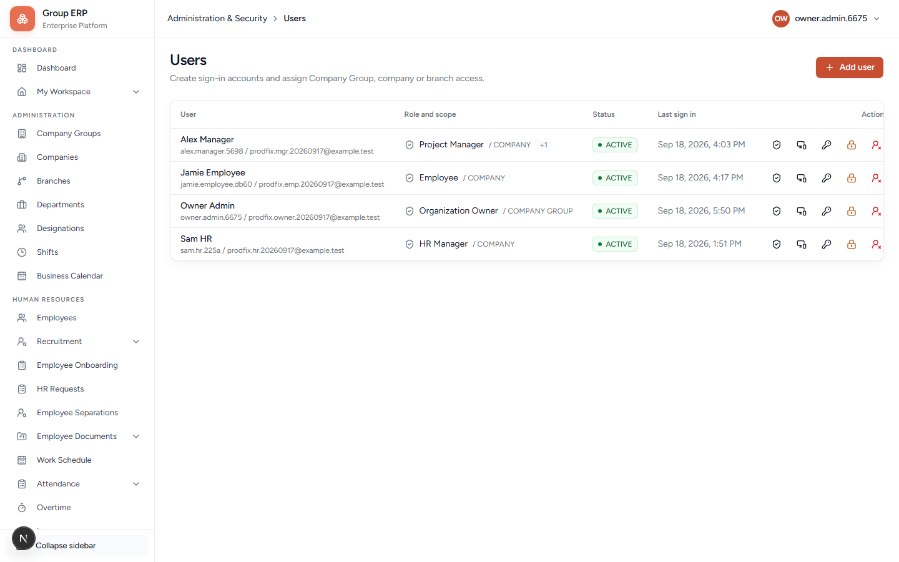
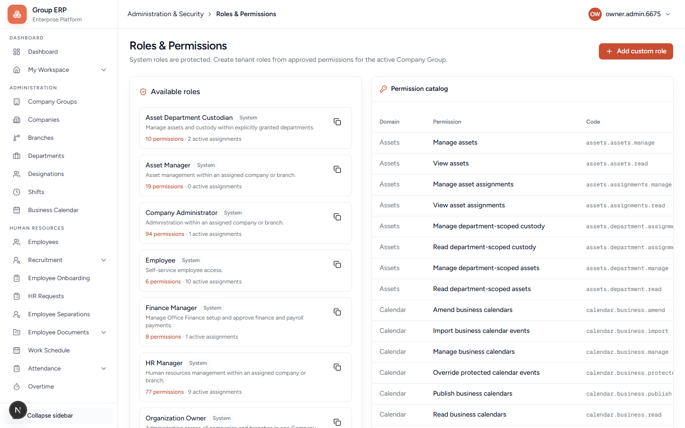

# 03 — Users, roles, and security

**Why this exists:** A User is the **login**. Roles decide which menus appear. Scope decides *which company/branch* those menus apply to. After a role change, the person should **log out and log in** to see the new menu.

**Who:** Organization Owner (Priya).

**Where:**

| Screen | Menu | URL |
|--------|------|-----|
| Users | Administration & Security → Users | `/administration/users` |
| Invite | Users → **Add user** | `/administration/users` then the invite form |
| Roles & Permissions | Administration & Security → Roles & Permissions | `/administration/security` |

Create **Employees first** ([chapter 04](./04-employees.md)), then come here to invite logins.

---

## Employee vs User (again)

| | Employee | User |
|--|----------|------|
| What | HR person | Login account |
| Where | HR → Employees | Administration & Security → Users |
| Without the other | Exists in HR lists; cannot open My Workspace | Can sometimes open admin screens; My Workspace says **Employee link required** |

Correct order for each person: **Employee → Invite User → Link to that Employee → Role + scope**.

From **Human Resources → Employees**, unlinked people show **Invite user**. That opens Add user with name, email, and linked employee already filled — you mainly add the role and send.

---

## Screen: Users list

You will see Priya (Owner) already. Use **Add user** to invite Arun, Meera, Rohan.

---

## Screen: Invite user

Click **Add user**. The invite form fields:

| Field | Required? | What it is for |
|-------|-----------|----------------|
| **Full name** | Yes | Name on the user record. Use the same as the employee (`Arun HR`). |
| **Email** | Yes | Login email. They receive an invitation (or, in local development, a bypass / “Open invitation” toast). |
| **Linked employee** | Strongly recommended | Connects this login to the HR person. Pick Meera / Arun / Rohan. If the list is empty, you did not create employees, or the lookup only shows managers — create employees first and refresh. |
| **Roles and access** | Yes (at least one) | Role + scope. See below. |
| **Send invitation** | — | Creates the user and starts invite. |

Local development may toast **Email delivery was bypassed** and offer **Open invitation**. Use that link to set the password. Do not paste the link into git.

### Roles (starter catalogue)

| Role you pick | Who it is for | What they can do (plain English) |
|---------------|---------------|----------------------------------|
| **Organization Owner** | Priya only (already assigned at register) | Full tenant admin. Do not give this to everyone. |
| **Company Administrator** | Rare extra admin | Company/branch administration without being the owner. |
| **HR Manager** | Arun HR | Employees, leave, calendar, onboarding, attendance review, most HR menus. |
| **Project Manager** | Meera if you will test projects | Projects, team timesheets. Meera still needs a manager-capable role for **leave team approve**. If leave manager queue is empty, give Meera a role that includes team approval (often HR Manager **or** a custom role with team approve) **scoped to the company**, or confirm the product’s manager path uses the reporting-manager employee link. |
| **Asset Manager** | Optional | Asset catalogues and assignments. |
| **Finance Manager** | Optional | Office Finance and payroll-related access when those modules are on. |
| **Employee** | Rohan | My Workspace, own leave, own punch. |
| **Super Administrator** | Platform only | Not for your company. Organization Owners cannot grant this. |

### Scope (where the role applies)

| Scope | Meaning | Use when |
|-------|---------|----------|
| **GLOBAL** | Whole platform | Never for Northstar staff. Super Admin only. |
| **COMPANY_GROUP** | Whole Northstar Labs organization | Owner-style access across companies in the group. |
| **COMPANY** | One legal entity | **Default for Arun, Meera, Rohan** — pick Northstar Labs Pvt Ltd. |
| **BRANCH** | One office only | If someone should see only Kochi Head Office. |

You add a role by choosing Role → Scope → Company (and Branch if needed) → add to the list → **Send invitation**.

### Northstar assignments

| User email (example) | Link to employee | Role | Scope |
|----------------------|------------------|------|--------|
| `northstar.hr@example.test` | Arun HR | **HR Manager** | Company = Northstar Labs Pvt Ltd |
| `northstar.mgr@example.test` | Meera Manager | **Project Manager** plus whatever is needed for team leave approve | Company |
| `northstar.emp@example.test` | Rohan Employee | **Employee** | Company or Branch Kochi |

**Pass when:** You can log out of Priya, open the invitation, set a password, and sign in as each of the three. Write passwords in your notepad.

---

## Screen: Roles & Permissions

This page is the catalogue of roles and which permission codes they include. For company testing you **assign existing roles** on invite. You do not need to invent permissions on day one.

If you open a role, you see codes such as `hr.employees.read`. Those codes match sidebar items. A missing menu almost always means: wrong role, wrong scope, or a **feature flag** (Projects / Finance / Payroll / Assets / Onboarding / Delivery) is off for this company.

---

## Login smoke (do this once)

| Login as | Should see |
|----------|------------|
| Rohan | My Workspace. Not the full Administration company-create path. |
| Meera | Team-related queues (leave manager / projects depending on role). |
| Arun | HR menus: Employees, Leave, Business Calendar, Onboarding. |
| Priya | Administration structure + Users. |

After any role change: **Sign out, Sign in**.

---

## Common errors

| Symptom | Fix |
|---------|-----|
| My Workspace: Employee link required | Edit the user / invite again and set **Linked employee**. |
| Menus empty after invite | Wrong role or scope. Check company = Northstar, not another company. |
| Leave submit: no eligible HR | Arun must be HR Manager **on this company**. |
| Manager leave queue empty | Rohan’s reporting manager must be Meera; Meera’s user must be linked to Meera’s employee. |
| Invitation email never arrives | In local/dev use **Open invitation** on the toast. |

SSO on the login page is not enabled — ignore it.

---

## Next

If employees are not created yet, go to [04 — Employees](./04-employees.md).
If they are, go to [05 — Calendar and work schedule](./05-calendar-and-work-schedule.md).
