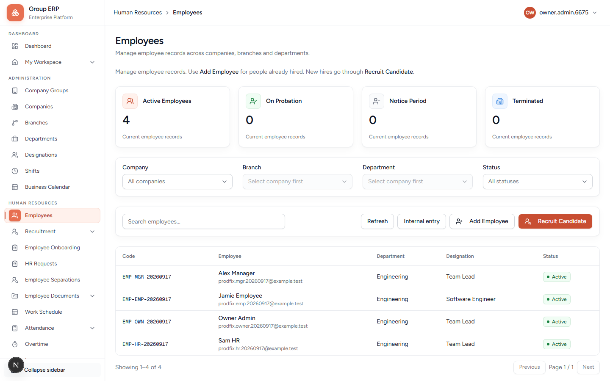

# 04 — Employees

**Why this exists:** An Employee is the **person in HR**. Leave, attendance, onboarding, payroll, and assets all point at this record. A login (User) without an Employee cannot use My Workspace.

**Who:** Organization Owner or HR Manager.

**Where:** Human Resources → Employees
**URL:** `/hr/employees`

Create people **before** you invite their logins (chapter 03).

---

## Screen: Employee list

Typical filters: Company, Branch, Department, Status. Always pick **Northstar Labs Pvt Ltd**.

**Add Employee** opens the create form. Use the button (a direct `/hr/employees/new` refresh can 404 in local dev).

The form has three blocks. Employee code (`EMP-…`) is generated on save.

### Personal Information

| Field | Required? | What it is for | Example |
|-------|-----------|----------------|---------|
| **First Name** | Yes | Given name. | `Meera` / `Arun` / `Rohan` |
| **Last Name** | No | Family name. | `Manager` / `HR` / `Employee` |
| **Email** | No | Contact email on the HR record. Can match the future login, but this field is **not** the login by itself. | `northstar.mgr@example.test` |
| **Mobile** | No | Phone. | optional |

### Organization

| Field | Required? | What it is for |
|-------|-----------|----------------|
| **Company** | Yes | Legal entity. Changing company clears branch, department, designation, manager. |
| **Branch** | Yes | Office. Disabled until company is chosen. Changing branch clears department. |
| **Department** | Yes | Team. Disabled until branch is chosen. |

### Employment

| Field | Required? | What it is for |
|-------|-----------|----------------|
| **Designation** | No for save; **needed** for leave matrix and onboarding templates | Job title from chapter 02. |
| **Reporting Manager** | No for save; **needed** for leave Manager approval | Another Employee in the same company. Cannot be themselves. |
| **Employee Type** | No | Dropdown: Permanent, Part-time, Freelance, Other (saved as text). |
| **Joining Date** | No | First day. Use today or a past date. |

---

## Create these three (order matters)

Always select **Northstar Labs Pvt Ltd** + **Kochi Head Office**.

### 1. Meera Manager first

| Field | Value |
|-------|--------|
| First / Last | Meera / Manager |
| Department | Engineering (or Human Resources if you prefer) |
| Designation | Team Lead |
| Reporting manager | leave empty (top of tree) |

Save. Write `EMP-…` in your notepad.

### 2. Arun HR

| Field | Value |
|-------|--------|
| First / Last | Arun / HR |
| Department | Human Resources |
| Designation | HR Manager |
| Reporting manager | Meera Manager (optional) |

### 3. Rohan Employee last

| Field | Value |
|-------|--------|
| First / Last | Rohan / Employee |
| Department | Engineering |
| Designation | Staff |
| Reporting manager | **Meera Manager** (required for leave) |

**Pass when:** Three rows exist; Rohan’s manager is Meera.

The Owner (Priya) may already have an employee profile created by setup. Do not duplicate Priya.

---

## Common errors

| Symptom | Cause |
|---------|--------|
| Branch dropdown empty | Company not selected, or no branch on that company |
| Department empty | Branch not selected |
| Designation empty | No designations for this company (chapter 02) |
| Manager list empty | No other employees yet — create Meera first |
| Later: My Workspace says employee link required | User was invited but not linked to this employee (chapter 03) |

---

## What you have not done yet

- These people **cannot log in** until you invite Users and link them.
- They cannot punch until a Work Schedule is published (chapter 05 + 09).
- They cannot apply leave until types, matrix, and balances exist (chapter 10).

---

## Next

[03 — Users, roles, security](./03-users-roles-security.md) — invite Arun, Meera, and Rohan and link each User to the Employee you just created.
