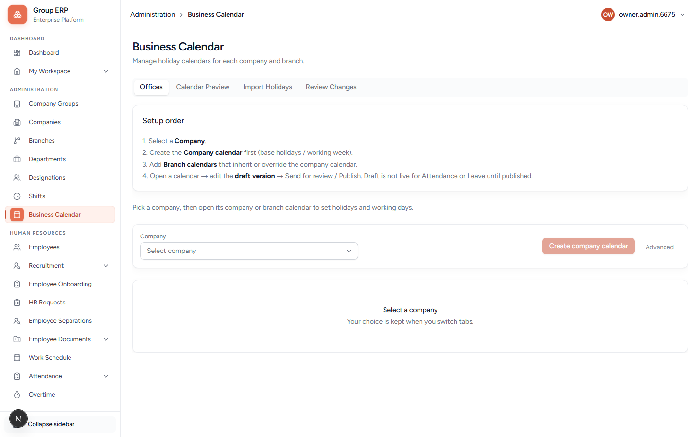
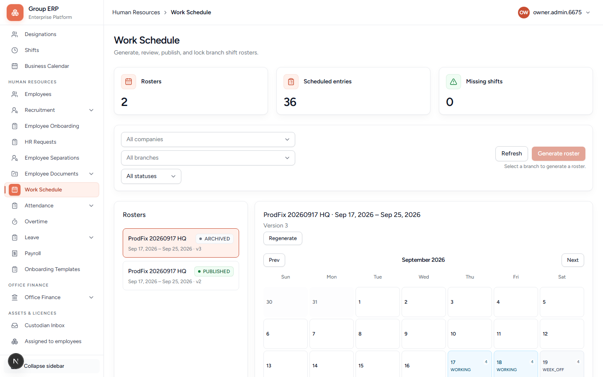

# 05 — Business Calendar and Work Schedule

**Why this exists:** Calendar answers “is the office open today?” Work Schedule answers “is this person expected to work today, on which shift?” Attendance punch uses **both**. Leave duration uses the calendar when it is in ACTIVE mode.

**Who:** Arun HR (HR Manager).

---

## 5.1 Business Calendar

**Menu:** Administration → Business Calendar
**URL:** `/administration/business-calendar`

The landing page shows **Setup order**:

1. Select a **Company**.
2. Create the **Company calendar** first (base holidays / working week).
3. Add **Branch calendars** that inherit or override the company calendar.
4. Open a calendar → edit the **draft version** → **Publish**. Draft is not live for Attendance or Leave until published.

Tabs: **Offices**, **Calendar Preview**, **Import Holidays**, **Review Changes**. **Advanced** is for later.

### Words on the screen

| Word | Meaning |
|------|---------|
| **Draft** | You can edit. Not used for live leave/attendance yet. |
| **Publish** | Makes this version live. |
| **Previous holiday source** | Office still reads holidays from HR → Leave → Holidays while its calendar transition is incomplete. Publishing Business Calendar alone does not change this. |
| **SHADOW** | Testing the new calendar; some leave math may still use old rules. |
| **ACTIVE** | Leave and attendance use Business Calendar holidays. Prefer this after Preview looks right. |
| **Preview** | Check one branch + date without changing anything. |
| **Imports / Impacts** | Advanced. Skip on day one. |
| **Create company calendar** | Starts the first calendar for a company that does not have one. |

### Preview

Stay on this page and click the **Calendar Preview** tab (do not paste `/administration/business-calendar/preview` into the address bar — that nested URL 404s in local Turbopack).

Pick **Northstar Labs Pvt Ltd**, **Kochi Head Office**, and a date. You should see working / week-off / holiday.

### Do this (Northstar)

1. Sign in as Arun.
2. Open Business Calendar → select **Northstar Labs Pvt Ltd** only.
3. **New draft** / create company calendar if none exists.
4. Set working week (Mon–Fri working, Sat–Sun off — or your real week).
5. **Add event** → Holiday, pick **one Date** (leave “Spans more than one day” off unless it is a multi-day festival), full day, on a **future weekday**.
6. For a normal office holiday leave **Optional / floating** off so the day closes the office. For a floating date turn **Optional / floating** **on** (effect stays open — office does not close).
7. **Publish**.
8. **Preview** → Kochi Head Office → that date: mandatory holiday shows non-working; optional/floating still shows **working**.

**Pass when:** Preview matches mandatory vs optional intent.

**Date tip:** One-day holidays need only a single date. If End is after Start, **every day in between** becomes that holiday (common mistake with Independence Day). Optional/floating holidays must be **single-day**.

### Annual holiday policy (optional / floating allowance)

After the Optional Holiday leave type exists (chapter 10), open **Annual holiday policy** on Business Calendar:

1. Company + year + **maximum holiday days** (example `10`).
2. Link the **Optional Holiday** leave type.
3. Save once for the company/year (not per branch).

Employees then choose floating dates on **My Workspace** (chapter 17). Allowance = maximum minus mandatory holidays that fall on working days. See [optional-floating-holidays-plan.md](../optional-floating-holidays-plan.md).

Related page: HR → Leave → Holidays lists published Business Calendar holidays (with Mandatory vs Optional / Floating badges) and identifies offices still completing transition. Use **Add holiday** there to open Business Calendar. Publishing alone does not switch office mode (LEGACY → SHADOW → ACTIVE); complete the transition before relying on the calendar for leave day-count.

---

## 5.2 Work Schedule (roster)

**Menu:** Human Resources → Work Schedule
**URL:** `/hr/work-schedule`

The landing cards show **Schedules**, **Employee days**, and **Missing shifts**.

Filters: **All companies**, **All branches**, **All statuses**. Always pick Northstar / Kochi (the hint under **Create schedule** says a branch is required).

The orange button is **Create schedule**. Schedule rows show statuses such as **Published** and **Archived**. The month grid marks **Working day** vs **Week off**.

There is no separate “pick employees” screen. Creation includes **all active employees on that branch**.

People are listed **by name** — open a person to see their days.

### Buttons and statuses

| Control | Meaning |
|---------|---------|
| **Draft** | Not live. Employees usually cannot punch against it. |
| **Empty draft only** | Empty schedule box for a date range. Not enough by itself (0 days). |
| **Create schedule / Rebuild** | Opens the create sheet (below). |
| **Preview first** | Check only. **New days to add** must be **> 0**. |
| **Save schedule** | Writes the employee × date rows into the draft. |
| **Publish** | Makes a filled Draft live. |
| **Published** | Attendance can use it. |
| **Lock** | Freeze so it cannot be edited. Use when the period is closed. |
| **Archive** | Retire an old schedule. |

### Create schedule sheet fields

| Field | What it is for |
|-------|----------------|
| **From / To date** | Date range to fill. Use a short range first (this week). |
| **Always preview before saving** | Keep on. Forces you to look at counts. |
| **Preview first** | Shows how many days would be added/updated, people included, and warnings — without saving. |
| **Empty draft only** | Makes the empty Draft box if you do not have one yet (no days filled). |
| **Save schedule** | Writes the employee × date rows into the draft. Needs a resolvable **shift** (company default Day Shift from chapter 02). |

If preview shows 0 new days: missing timezone on the branch, no employees on the branch, or no default shift.

### Do this

1. Confirm **Day Shift** exists and is default (chapter 02).
2. HR → Work Schedule → Northstar / Kochi.
3. Create schedule → set this week’s dates → **Preview first**.
4. New days to add > 0 → **Save schedule**.
5. Confirm Rohan appears under People (open his name to see days).
6. **Publish**.

**Pass when:** Status is Published and Rohan has entries for working days.

Rohan should then see shifts on **My Workspace → My calendar**.

---

## Next

For punching, go to [09 — Attendance](./09-attendance.md).
For leave, you also need chapter 10. You can do leave before attendance if the calendar is published.
