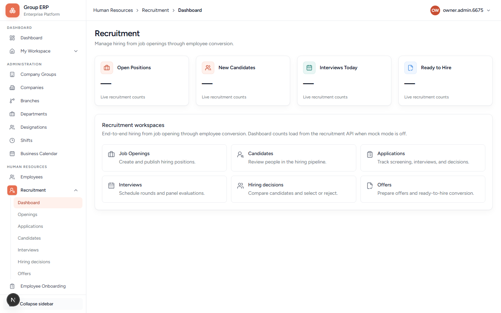

# 06 — Recruitment (optional hire path)

**Why this exists:** Full hiring loop. For your own company on day one you can **skip this** and create employees directly (chapter 04). Use this chapter when you want Opening → Application → Interview → Offer → Convert.

**Who:** Arun HR. Candidate uses public careers / offer links (no employee login yet).

**Flag:** Sidebar **Human Resources → Recruitment** appears only if the recruitment feature is on for this company.

---

## Dashboard

**URL:** `/hr/recruitment`



Tiles: **Open Positions**, **New Candidates**, **Interviews Today**, **Ready to Hire**.

Workspaces on the same page: **Job Openings**, **Candidates**, **Applications**, **Interviews**, **Hiring decisions**, **Offers**. Click those cards or the matching sidebar items.

Openings and the rest of the pipeline are nested under Recruitment. In local Turbopack, **pasting** `/hr/recruitment/openings` (and similar) can 404 — always click **Openings** in the sidebar or **Job Openings** on this dashboard.

---

## Openings

Create a vacancy, then publish it before candidates can apply.

### New opening — important fields

| Field | What it is for |
|-------|----------------|
| **Title** | Job title on the careers page. |
| **Description** | What the role is. |
| **Employment type** | Permanent / contract / intern, etc. |
| **Location** | Office or remote text. |
| **Company group / Company / Branch / Department / Designation** | Where the hire will sit. Designation should match the onboarding template you will use. |
| **Hiring manager** | Employee who owns the vacancy (often Meera). |
| **Headcount** | How many seats. |
| **Target joining date** | Planned start. |
| **Application deadline** | Last day to apply. |
| **Criteria** | Weighted scoring items for interviews. |

Draft → publish. Until published it is only a plan.

---

## Rest of the pipeline

| Page | What it is for |
|------|----------------|
| Applications | People who applied |
| Candidates | Candidate records |
| Interviews | Schedule / evaluate |
| Offers | Offer letter |
| Hiring decisions | Select / reject |
| Delivery | Email status (an empty queue is expected when delivery is not configured) |

Public: `/careers/{companyCode}` and `/offer-response`.

---

## Happy path

```text
Create Opening (published, linked to designation + department)
    → Candidate applies (careers or HR adds application)
    → Interview
    → Hiring decision
    → Offer → candidate accepts / uploads signed offer
    → Convert to Employee (preflight)
    → Invitation to login
    → Hand off to Employee Onboarding (chapter 07)
```

Convert is the handoff. Do not convert until the offer is accepted. After convert, the person is an Employee — continue like chapter 04 + 07.

---

## Next

[07 — Onboarding](./07-onboarding.md) after convert, or skip recruitment and start onboarding for Rohan created in chapter 04.
