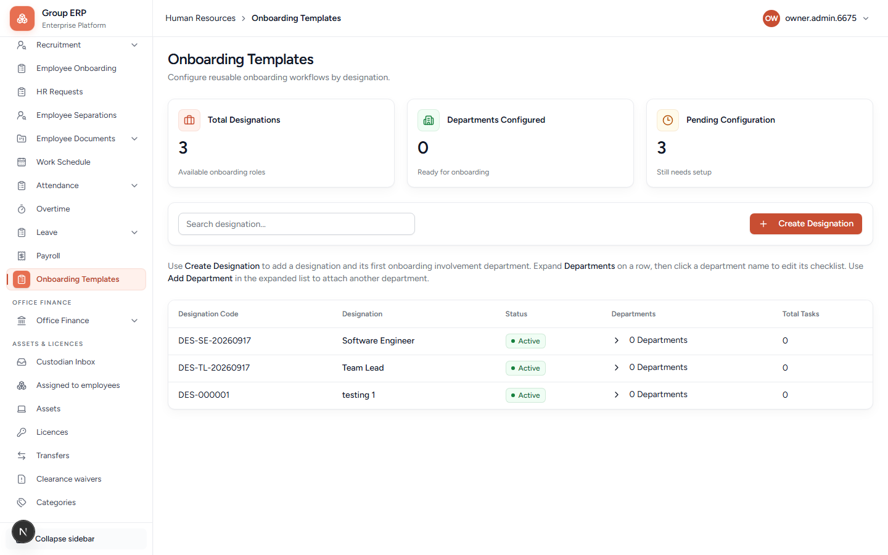
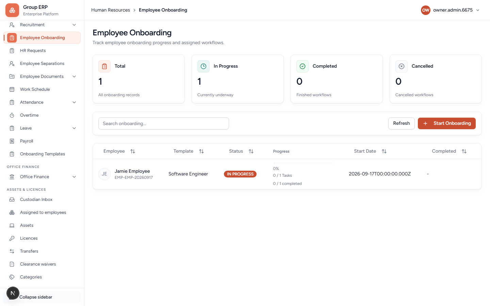

# 07 — Employee onboarding (joining checklist)

**Why this exists:** After someone is hired (or created as an employee), HR runs a joining checklist: ID proof, laptop, bank details, and so on.

This is **not** the organization setup hub from chapter 01.

**Who:** Arun HR builds and starts. Rohan sees the list on My Workspace. Today, **HR still completes most tasks** in Employee Onboarding. Department-head assignment (IT does IT work) is the intended design but is **not fully live** yet — do not wait for an IT inbox that is not there.

**Flag:** Onboarding menus need the onboarding module on.

---

## Templates

**Menu:** Human Resources → Onboarding Templates
**URL:** `/hr/onboarding-templates`

Cards: **Total Designations**, **Departments Configured**, **Pending Configuration**.

There is **no blank New template**. Rows are **per designation**. The orange button is **+ Create Designation** (adds a designation *and* its first onboarding department). Use that only if Staff does not exist yet — otherwise stay on the Staff / equivalent row from chapter 02.

On the list: **Search designation**, then expand **Departments** on a row. **Add Department** attaches another department to that designation’s checklist.

### Intended rule (locked product decision)

On the template, assign work to a **department** (IT, HR, Finance), not to a named person. People change; departments stay.

### Do this for Staff

1. Find the **Staff** row (or create the designation if the table is empty).
2. Expand **Departments** (click the department count; stay on the same page).
3. Add/open department **Human Resources** (and others if listed).
4. **Add Task Group** → e.g. `Day 1`.
5. **+ Add Task** → `Submit ID copy` → save.
6. **Validate** → **Publish**.

Until published, it is only a plan.

---

## Start for one employee

**Menu:** Human Resources → Employee Onboarding
**URL:** `/hr/employee-onboarding`

Cards: **Total**, **In Progress**, **Completed**, **Cancelled**. Orange button: **+ Start Onboarding**.

**Start Onboarding** opens a form:

| Field | Required? | What it is for |
|-------|-----------|----------------|
| **Employee** | Yes | Rohan Employee |
| **Start date** | Yes | Joining / checklist start |
| **Remarks** | No | Internal note |

The system uses the **published template for that employee’s designation**. If Staff has no published template, start will fail with a clear blocker — fix the template first.

### Complete

My Workspace shows tasks as pending; there may be **no Complete button** for the employee yet.

1. Arun → Employee Onboarding → Rohan’s row.
2. On **Submit ID copy** → **Start** → **Complete**.

Employee view: My Workspace → Onboarding (`/my-workspace/onboarding`). Tabs there: **My Tasks** and **Department Queue**. Empty is honest if HR has not started an instance.

**Pass when:** Template published, instance started, at least one task completed.

---

## Next

[08 — Employee documents](./08-employee-documents.md) if you need file types. Otherwise [09 — Attendance](./09-attendance.md) after a published work schedule.
