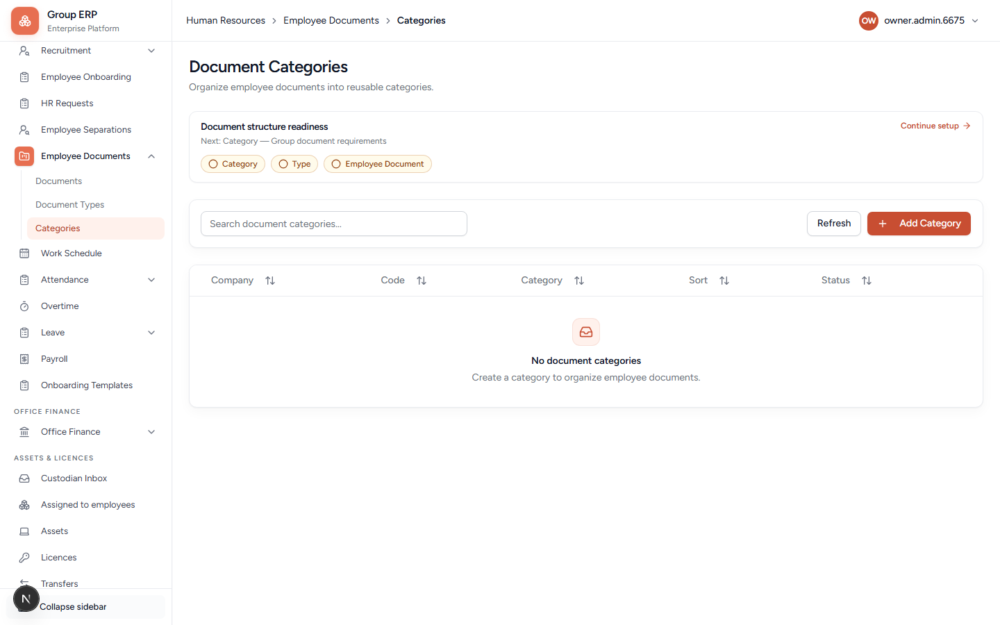
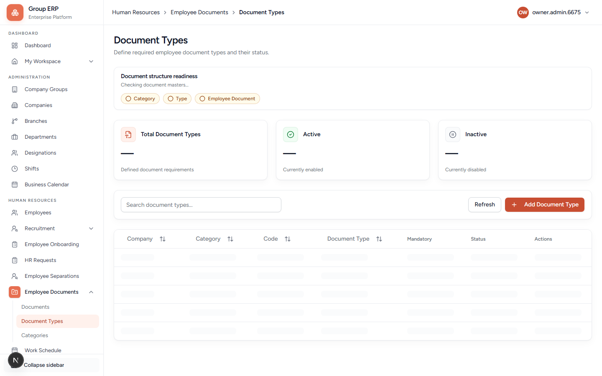
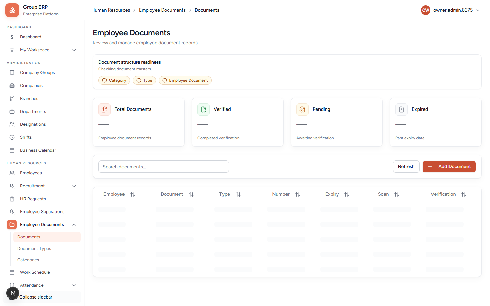

# 08 — Employee documents

**Why this exists:** Controlled files on the employee (ID, contracts). Download should only work for files the scanner marked **Clean**.

**Who:** Arun HR.

**Order:** Category → Type → Document.

---

## Categories

**URL:** `/hr/employee-document-categories`

Folders of types (Identity, Payroll, …). **+ Add Category** creates one. The readiness strip is **Category → Type → Employee Document**.

---

## Document types

**URL:** `/hr/employee-document-types`

Kind of file (Passport, Aadhaar, Offer letter), each under a category.

---

## Documents

**URL:** `/hr/employee-documents`

Actual files on an employee.

| Idea | Meaning |
|------|---------|
| **Clean** | Scan passed. Download allowed. |
| **Pending / Infected / Error** | Honest status. Do not treat as a silent empty file. Only Clean should download. |

Local development may skip a live virus scanner. Production needs a real scanner.

**Pass when:** You can create a category, a type under it, upload one file on Rohan, and see a scan state.

---

## Next

[09 — Attendance](./09-attendance.md) or [11 — Assets](./11-assets-and-licences.md).
