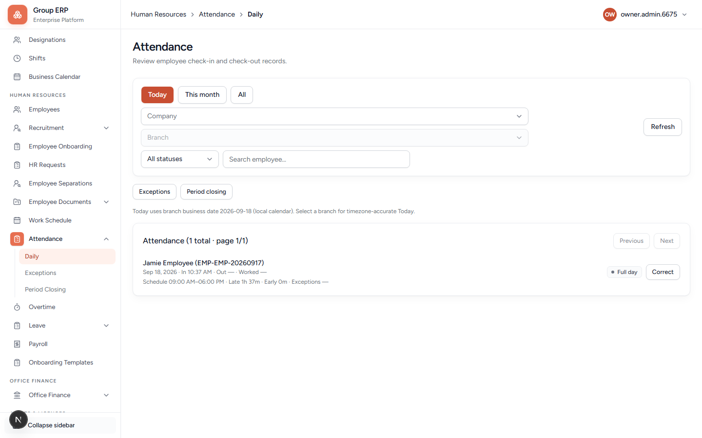

# 09 — Attendance

**Why this exists:** Daily in/out. Punch only works on a **published working day** (calendar + work schedule from chapter 05).

**Who:** Rohan punches. Arun reviews.

---

## Employee punch

**Menu:** My Workspace → Overview
**URL:** `/my-workspace`

Open **My Workspace → Overview** from the sidebar. Punch lives on that page (orange **Check in**, grey **Check out**).

| Control | Meaning |
|---------|---------|
| **Check in** | Start of work. Time uses the **branch timezone**. |
| **Check out** | End of work. Enabled after a successful check-in. |
| **Apply leave** | Opens leave (from Overview this can 404 in local Turbopack; use **My calendar → Apply leave** instead — chapter 10). |
| **Today's Shift** | Published shift name and hours. |
| **Today's attendance** | In / Out times. |
| Missing punch buttons | Roster not published, today is holiday/week-off, no employee link, or already punched. |

**Do this:** Rohan → My Workspace → **Check in** (then **Check out** if shown).

---

## HR — Daily

**Menu:** Human Resources → Attendance → Daily
**URL:** `/hr/attendance`

Who punched, who is absent/leave. Filters on this page:

| Control | What it is for |
|---------|----------------|
| **Today / This month / All** | Date range. Start with **Today**. |
| **Company / Branch** | Must be Northstar / Kochi. The page reminds you a branch is needed for timezone-accurate “today”. |
| **All statuses** | Filter by punch state. |
| **Search employee** | Find Rohan. |
| **Refresh** | Reload after a punch. |
| **Fix punch issues (Exceptions)** | Late / missing punch / short hours. Propose fix → Approve. |
| **Close the month (Period closing)** | Lock a month when payroll needs a freeze. Do this after exceptions are cleared — not on day one. |
| **Correct** | HR can fix punches on the Daily row with a reason (immediate). |
| **View issues** | Opens Exceptions for that employee when the day has open problems. |

### Why Propose fix and Approve are separate

**As HR, prefer Daily → Correct.** That updates the day and clears exceptions in one step. You do not need Propose fix → Approve.

1. Punch looks wrong on **Daily** → system opens an **exception**.
2. **HR Correct** = fix times / status with a reason → exceptions cleared. Done.
3. **Propose fix** (optional path) = suggest new times for a **manager** to Approve. If you Propose as HR, Approve may fail with “waiting on the assigned approver” — that means Meera (manager), not you.
4. **Period closing** locks the month only when open / waiting issues are gone.

**Pass when:** Arun sees Rohan’s punch for today on Daily attendance.

---

## Next

[10 — Leave and overtime](./10-leave-overtime.md)
