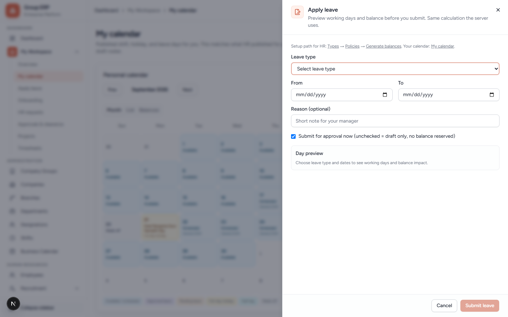
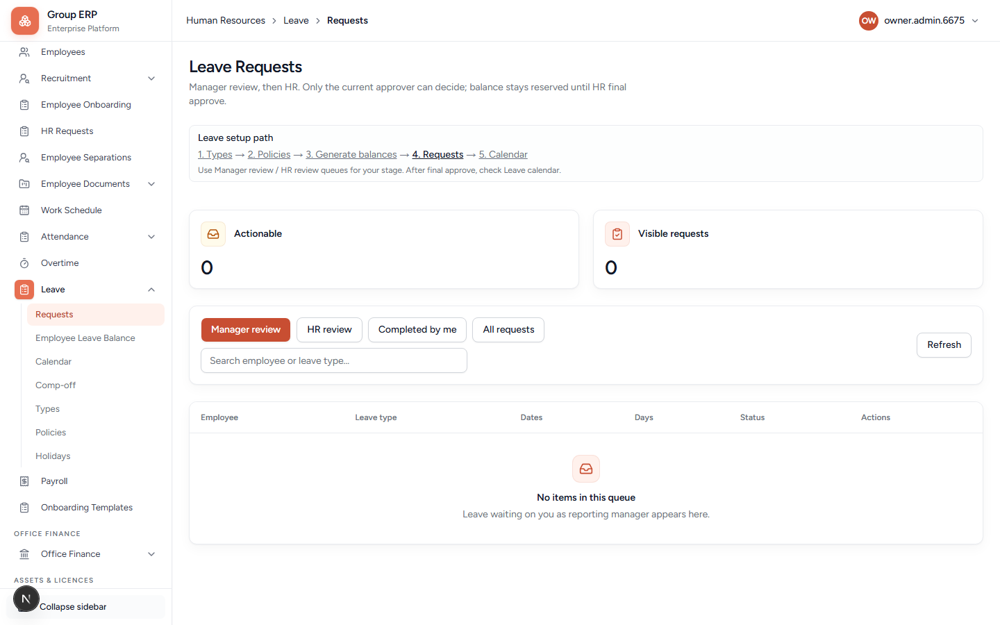
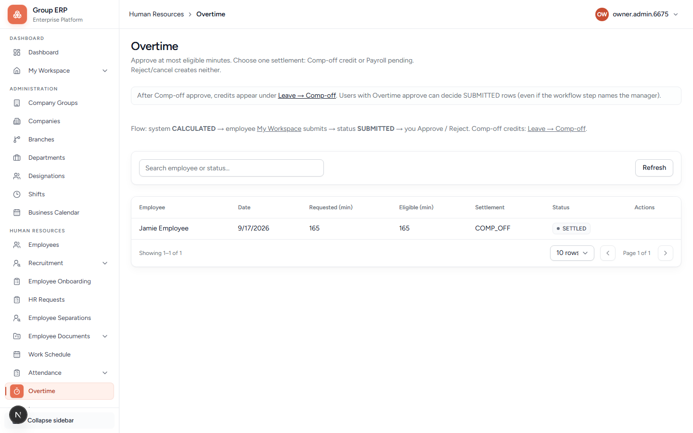

# 10 — Leave and overtime

**Why this exists:** Time off and extra hours. Leave is **not** the same as an HR letter request (chapter 12).

**Who:** Arun configures. Rohan applies. Meera manager-approves. Arun HR-approves.

---

## Build order (do not skip)

The Leave Requests page prints this path:

```text
1. Types → 2. Policies → 3. Generate balances → 4. Requests → 5. Calendar
```

Saving the matrix **does not** create balances by itself.

The policy screen says **days per year** (for example 12 or 18.5). That is the current product. Do not enter “2 meaning 2 per month” unless a later UI change says so.

Open Types / Policies / Balances / Calendar / Comp-off from **Leave** in the sidebar. Pasting those nested URLs in local Turbopack can 404.

---

## 10.1 Leave types

**Menu:** Human Resources → Leave → Types
**URL:** `/hr/leave/types`

Create **Casual Leave** for Northstar Labs Pvt Ltd.

### New type fields

| Field | Required? | What it is for | Northstar |
|-------|-----------|----------------|-----------|
| **Company** | Yes | Type belongs to this company only. Locked after save. | Northstar Labs Pvt Ltd |
| **Name** | Yes | Label employees see. Spelling does not unlock Comp-off — use **Kind**. Code is created automatically (Casual Leave → `CL`). | `Casual Leave` or `Comp-off` |
| **Kind** | Yes | **Standard** = normal leave. **Comp-off** = spends overtime credits (required for Leave → Comp-off to work). **Unpaid** = unpaid leave. **Optional Holiday** = floating/optional catalog leave (paid, no half-day; **Requires approval** is company choice) — used only via My Workspace selection, not Apply Leave. | Standard for Casual; Comp-off for compensatory off; Optional Holiday once for floating holidays |
| **Description** | No | Notes. | optional |
| **Paid leave** | — | On = paid. | on (including Optional Holiday) |
| **Requires approval** | — | On = Manager then HR. Leave this **on** for Casual. For **Optional Holiday**, company chooses: **on** = new picks need approval; **off** = auto-approve on selection. | on for Casual; company choice for Optional Holiday |
| **Allow half day** | — | Employee can apply 0.5 day. Off for Optional Holiday. | optional / off for OH |
| **Carry forward allowed** | — | On/off only. The **number of days** is set under Policies → By leave type → Edit. Off for Optional Holiday. | off for first test |

---

## 10.2 Policies (matrix)

**Menu:** Human Resources → Leave → Policies
**URL:** `/hr/leave/policies`

Two views:

| Button | What it is for |
|--------|----------------|
| **Days by job role** | Grid: rows = job roles (Staff, Manager…), columns = leave types, cell = **days per year**. Use this to give Staff Casual Leave. |
| **Rules by leave type** | For each leave type: **Carry forward** max days (**Edit**), and whether balance can go below zero. Leave Types only turns carry forward on/off. |

### Matrix filters and save

| Control | What it is for |
|---------|----------------|
| **Company / Branch** | Must be Northstar / Kochi. Matrix loads after Branch. |
| **All departments** | Optional filter. Leave empty for the whole office. |
| **Search designations** | Find Staff. |
| Checkbox on a cell | Enable that designation × type. |
| Days box | Days **per year**, > 0. Example `12`. |
| **Reason** | Required on save (why you changed the matrix). |
| **Save** | Updates the rules for this office. Cells left off are disabled. |

**0 days** while enabled must be **rejected**. After save, existing employee balances are **not** recalculated — generate balances next.

**Carry forward:** unused days that may move into next year. **Who edits:** HR on Rules by leave type → Edit. **For whom:** everyone on that leave type at that branch.

**Balance below zero — Not allowed:** employee cannot request leave with 0 days left.

---

## 10.3 Balances

**URL:** `/hr/leave/balances` (sidebar: **Employee Leave Balance**)

Lists employees and their balances. Expand Rohan.

1. **Give employees their leave days** (Generate).
2. Year = current year. Company = Northstar (recommended).
3. Keep **Preview only** → Preview first. Check “New balances to add”.
4. Uncheck Preview only → **Create balances** → Refresh.
5. Expand **Rohan Employee** → Casual Leave entitlement should match the matrix (e.g. 12).

---

## 10.4 Apply (employee)

**Menu:** My Work → **My leave** → **Apply leave**

The Overview **Apply leave** shortcut opens the canonical `/my-workspace/leave?action=apply` workflow. From My calendar, selecting **Apply leave for this date** opens the same workflow with the date prefilled.



| Field | What it is for |
|-------|----------------|
| **Leave type** | Casual Leave (must exist from 10.1). Empty list means HR has not created types. |
| **From / To** | Inclusive dates. Pick a **working** day (not your calendar holiday). |
| **Half day** | Only if the type allows it; same date only. |
| **Reason** | Optional note for Meera. |
| **Submit for approval now** | On = manager queue. Off = draft, **no balance reserved**. |
| **Day preview** | Working days and balance impact **before** submit. Wait until it says ready. |
| **Submit leave** | Sends the request. **Cancel** closes without saving. |

Status **SUBMITTED**; days go to **pending**. No Approve button on Rohan’s own request.

**Optional / floating holidays:** do **not** use Apply Leave for the Optional Holiday type. Configure the leave type + annual holiday policy (chapter 05), then Rohan picks dates on **My Workspace → Overview** (multi-select card). On the leave type, set **Requires approval** on or off per company: **off** = auto-approved on save; **on** = Manager/HR leave approval for new picks. Employees can change future picks later (removals cancel immediately; new adds follow the same approval rule). Same-day changes stay blocked. Full product rules: [optional-floating-holidays-plan.md](../optional-floating-holidays-plan.md).

---

## 10.5 Requests (Manager then HR)

**URL:** `/hr/leave`



Queues depend on who you are: **Manager review** (reporting managers only), **HR review** (HR only). Also **Completed by me** and **All requests**. Search by employee or leave type.

| Step | Who | What you should see |
|------|-----|---------------------|
| 1 | Rohan applies | SUBMITTED, days in **pending** |
| 2 | Meera → **Manager review** → Approve **once** | Still SUBMITTED; stage moves to HR (not fully approved) |
| 3 | Meera approves again | Should **fail** / not allowed |
| 4 | Arun → **HR review** → Approve | APPROVED; used↑ pending↓ |
| 5 | Rohan | Cannot approve own request |

Only the **current** approver can decide. Balance stays reserved until HR final approve.

---

## 10.6 Calendar, holidays, overtime, comp-off

| Page | Screenshot | What it is for |
|------|------------|----------------|
| Leave calendar | Open **Leave → Calendar** in the sidebar | Team month: purple days show **who** is off (name + leave type). Side panel lists everyone on leave this month without clicking a day. Pick one employee for their personal calendar. |
| Holidays | Open **Leave → Holidays** | Shows **published** holidays from Business Calendar. **Add holiday** opens Business Calendar. |
| Comp-off | Open **Leave → Comp-off** | Credits from approved overtime. Needs a leave type with **Kind = Comp-off** (name spelling does not matter). |
| Overtime `/hr/overtime` |  | Extra hours requests |

Overtime and comp-off are not HR Request types. Configure after attendance exists so hours make sense.

**Pass when:** The Manager → HR chain works only on Northstar data.

---

## Next

[11 — Assets](./11-assets-and-licences.md) or [17 — My Workspace](./17-my-workspace-daily-work.md).
