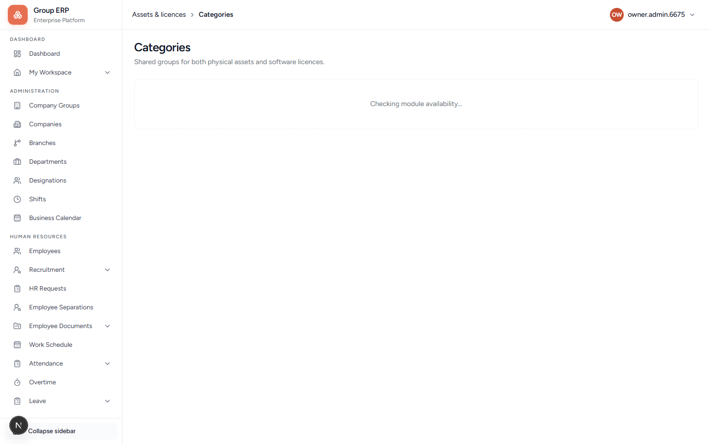
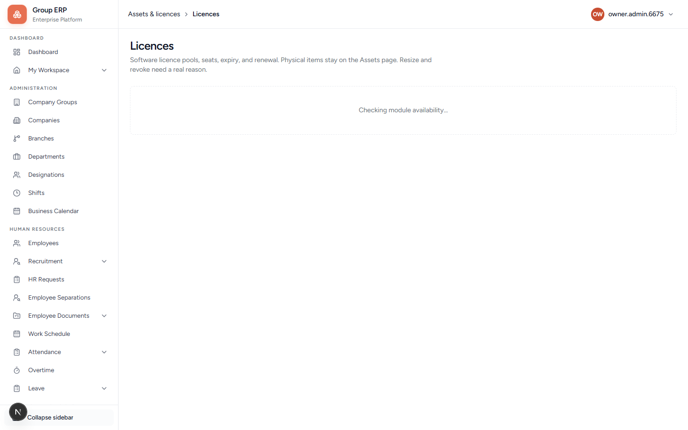
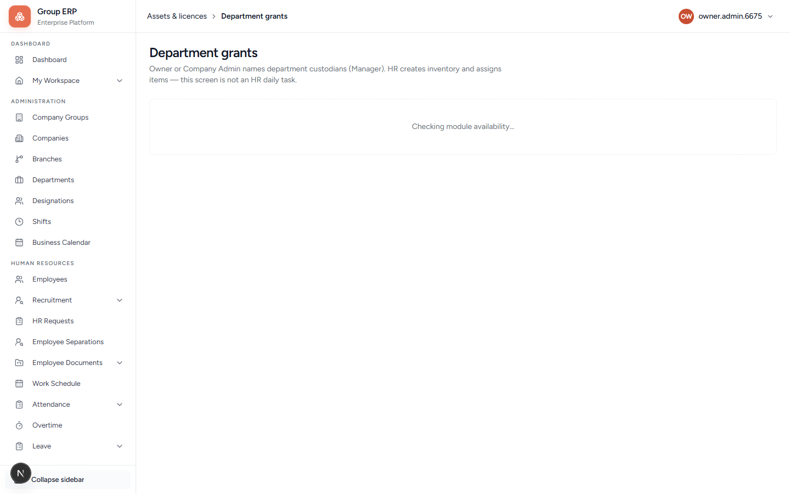
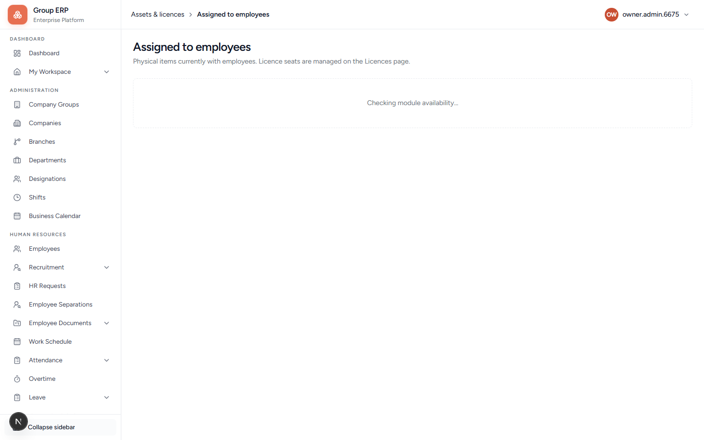
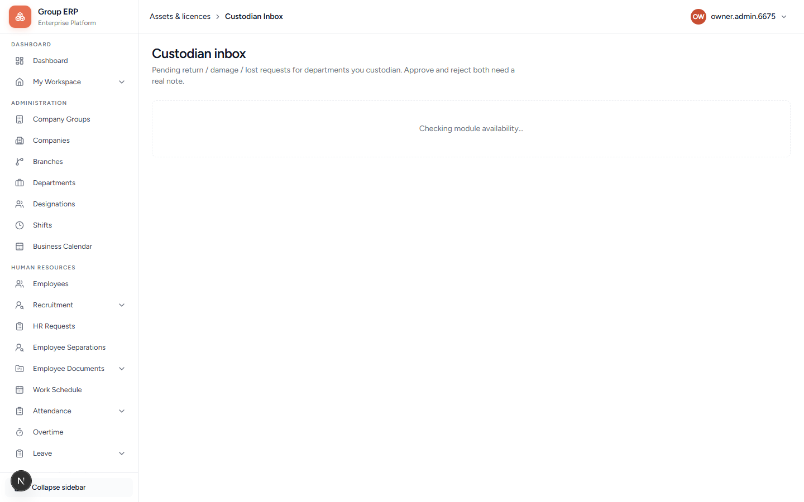

# 11 — Assets and licences

**Why this exists:** Track laptops, phones, and software licences: who holds them, department pools, transfers, and clearance when someone leaves.

**Who:** Owner / HR assigns. Meera (custodian) decides return/damage in Inbox. Rohan acknowledges on My Workspace.

**Flag:** **Assets & licences** menu needs the asset module on.

---

## Order to create

```text
Category (Laptop, Phone, Software)
    → Type (MacBook Air, Adobe)
        → Asset or Licence record
            → Assign to employee or grant custodian for department
                → Employee acknowledges
                    → Return via Custodian Inbox (or transfer / exit waiver if needed)
```

Codes for category / type / asset are generated.

---

## Setup pages

| Page | Screenshot | What it is for |
|------|------------|----------------|
| Categories `/asset-management/asset-categories` |  | Top grouping. Fields: Company, Name, Description. |
| Types `/asset-management/asset-types` |  | Kind of item, under a category |
| Assets `/asset-management/assets` |  | Physical / numbered items |
| Licences `/asset-management/licenses` |  | Seat-based software |
| Department grants `/asset-management/department-grants` |  | Name custodians (e.g. Meera for Engineering). They decide return/damage in **Custodian Inbox** after re-login — not the same as assigning an item. |

---

## Daily pages

| Page | Screenshot | What it is for |
|------|------------|----------------|
| Assigned to employees `/asset-management/employee-assets` |  | Who has what |
| Custodian Inbox `/asset-management/inbox` |  | Approve return / damage / lost / licence revoke |
| Transfers `/asset-management/transfers` |  | Move hardware **department → department** (not person assign) |
| Clearance waivers `/asset-management/waivers` | — | Exit only: skip a stuck asset so separation can finish |

**Do this once:** Category `Laptop` → Type `MacBook Air` → Asset → Assign to Rohan. Category `Software` → Type `Adobe` → Licences pool → Give seat to Rohan. Rohan sees both on My Workspace. **Assigned to employees** lists physical items and licence seats separately.

**Pass when:** Rohan appears under physical items and under licence seats (or on Licences → Open seats).

---

## Simple checks (what is left after Inbox)

### Transfers (optional day-to-day)

**Meaning:** Laptop belongs to Engineering; you want Sales to own it instead.

**How to check:**
1. Owner/HR: **Assets** → open a free/in-stock item → **Transfer** to another department.
2. Destination custodian (or Owner): **Transfers** → Accept.
3. Empty list = nothing pending (normal).

Not for: giving Rohan a laptop (that is **Assign**). Licences are not transferred here.

### Clearance waivers (exit only — skip for normal testing)

**Meaning:** Someone is leaving; they still “owe” a laptop that cannot be returned. HR requests a **waiver** so exit can complete.

**How to check:** Only appears during **employee separation / clearance**. Empty list on normal days is correct. Day-to-day returns use **Custodian Inbox**, not waivers.

### Employee request status

On **My Workspace → My assets**, after **Request return**, status becomes **Return requested** (waiting on custodian). Buttons hide until the request is finished.

---

## Next

[12 — HR requests and separations](./12-hr-requests-and-separations.md)
