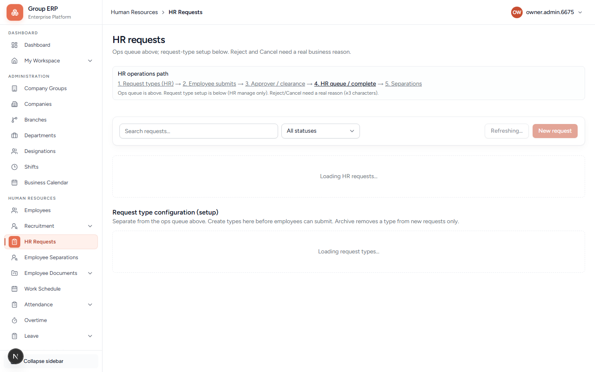
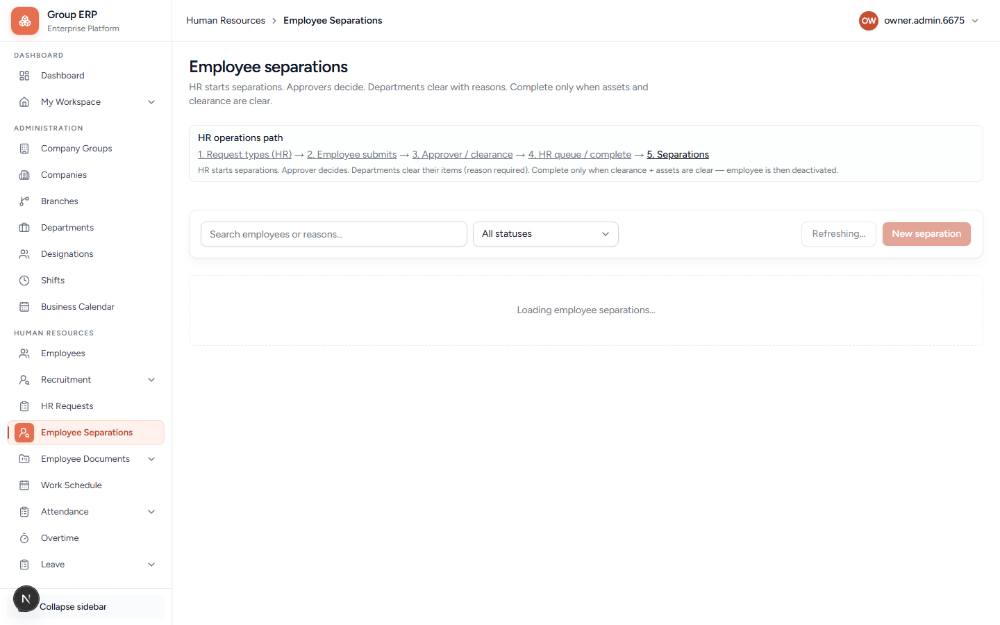

# 12 — HR requests and separations

**Why this exists:**

- **HR Request** = paperwork **while employed** (experience letter, address proof).
- **Separation** = the person is **leaving** (exit, clearance, last working day).

These are not leave and not overtime.

**Who:** Arun configures types and Completes. Rohan submits. Meera Approves.

---

## HR Requests

**Menu:** Human Resources → HR Requests
**URL:** `/hr/hr-requests`

### Important

**New request** always belongs to the **person who is logged in**. There is no “pick employee” box.
So if Arun clicks New request, the Employee column shows **Arun HR** — that is correct.

### How employees know a type exists

HR does **not** pick which employee gets the type. Creating **Employment letter** puts it in the **company catalog**.

- Every employee with a linked login opens **My Workspace → HR requests**.
- They see **What you can request** (e.g. Employment letter / `HRT-00001`).
- Whoever **needs** that paper clicks **Request this** — for themselves only.

So if there are 50 employees: only people who need a letter submit. Others ignore it. There is no push message today; discovery is on that page (HR can also tell people in chat/email).

### Practice path (recommended)

1. Arun: create request type once (name only — code like `HRT-00001` is auto).
2. **Rohan** logs in → **My Workspace → HR requests** → sees Employment letter → Request this.
3. **Meera** logs in → **My Workspace → Approvals & clearance** → Approve.
4. **Arun** on `/hr/hr-requests` → Complete when status is APPROVED.

**Waiting on** shows the approver’s name (e.g. Waiting on Meera Manager).

**Attachment:** optional when submitting. On the request row (and when Approving/Completing) everyone sees **No attachment** or **View file**. Meera checks it on Approvals; Arun on the HR queue.

**Pass when:** Rohan can submit one request and see status move through approval to complete.

---

## Employee Separations

**Meaning:** Someone is **leaving the company** (resignation, termination, etc.). This is not an HR request letter.

**Who starts it:** Arun (HR) on this screen — not the employee.

**Menu:** Human Resources → Employee Separations
**URL:** `/hr/employee-separations`

### Fill the form (what you are looking at)

| Field | What to put |
|-------|-------------|
| **Employee** | Who is leaving (e.g. Testing Employee). Prefer a dummy — do not exit Rohan if you still need him for leave/attendance. |
| **Separation type** | Why they leave (Resignation, Termination, …). |
| **Last working date** | Their last day in office. |
| **Reason** | Short business reason (at least 3 characters). |
| **Clearance departments** | Which departments must tick off exit tasks (HR / Finance / IT / Admin). Pick an active department for each row in that employee’s company/branch. Asset return is **not** set here — the system checks assets later. |

**Fill the form → Submit.** If this is the first separation in the company, the app creates the **Manager Approves** workflow automatically (same idea as HR request types).

### What happens next

1. Status → **Pending approval** → Manager (Meera) opens **My Workspace → Approvals & clearance** → Approve.
2. Status → **Clearance in progress** → Meera (if she is in that department) or Arun HR clears each item on **Approvals → Department clearance** (Clear needs a reason). Managers can clear their own department; HR can clear any department checklist.
3. If they still hold assets, return/waive them first (Custodian Inbox / Clearance waivers).
4. Arun opens the separation **detail** → **Complete** only when clearance + assets are clear. Employee is then deactivated.

**Pass when:** one dummy employee moves Submit → Approve → Clearance → Complete.

**Skip for now** if you still need Rohan/Meera for other chapters — use a spare test employee only.

---

## Next

[13 — Projects and timesheets](./13-projects-and-timesheets.md)
