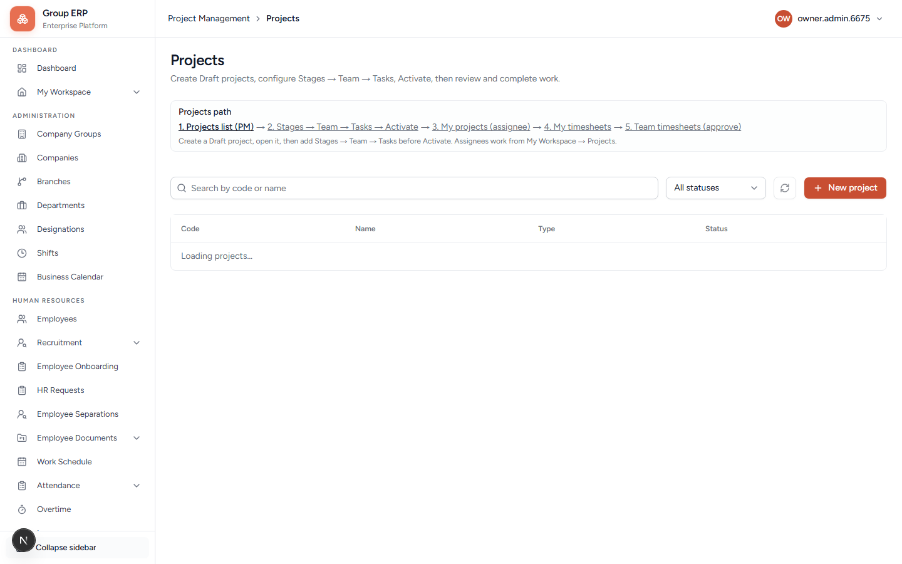
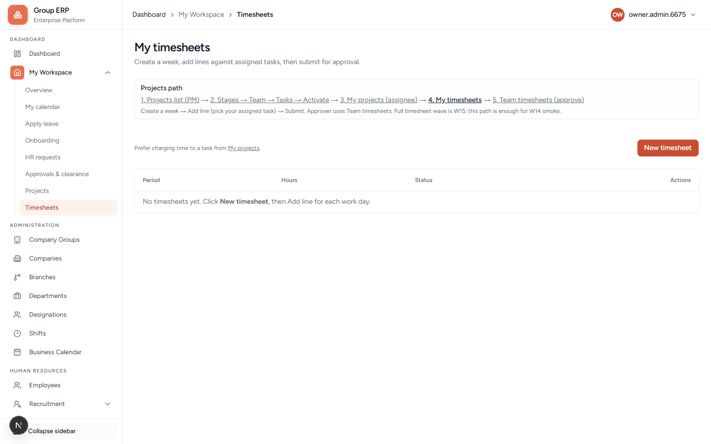
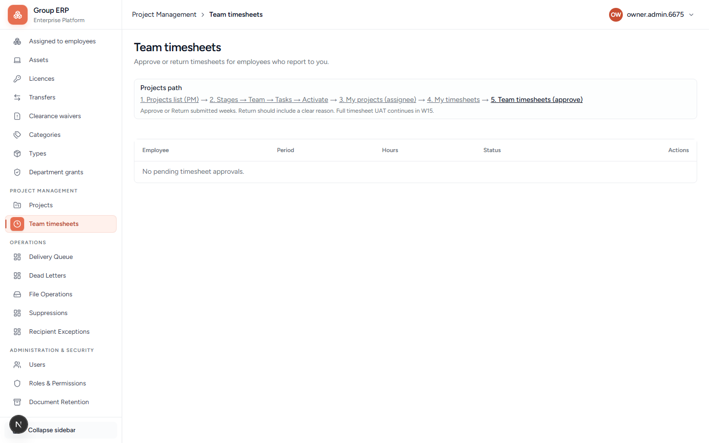

# 13 — Projects and timesheets

**Why this exists:** Delivery of work: project → stages → team → tasks → time.

**Who:** Meera (Project Manager) owns the project. Rohan works tasks and submits time. Meera approves timesheets.

**Flag:** **Project Management** and My Workspace Projects/Timesheets need the projects module on.

---

## Projects

**URL:** `/projects/projects`

Create a project on Northstar Labs Pvt Ltd. Detail tabs typically include Overview, Stages, Team, Tasks, Documents, Time, Finance.

---

## Timesheets

| Who | Page | Screenshot |
|-----|------|------------|
| Rohan | My Workspace → Timesheets `/my-workspace/timesheets` |  |
| Meera | Project Management → Team timesheets `/team/timesheets` |  |

Team timesheets shows the projects path: Projects → Stages/Team/Tasks → My projects → My timesheets → **Team timesheets (approve)**. Empty “No pending timesheet approvals” is the honest day-one state.

`/projects/resources` is **not a usable module yet** — treat as deferred.

---

## Happy path

1. Meera creates a project on Northstar Labs Pvt Ltd.
2. Add stages (optional but typical).
3. Add team: Meera + Rohan.
4. Add a task assigned to Rohan.
5. Rohan works the task from My Projects.
6. Rohan submits a timesheet.
7. Meera approves on Team timesheets.

**Pass when:** Submitted time is approved and visible on the project.

---

## Next

[14 — Office Finance](./14-office-finance.md)
