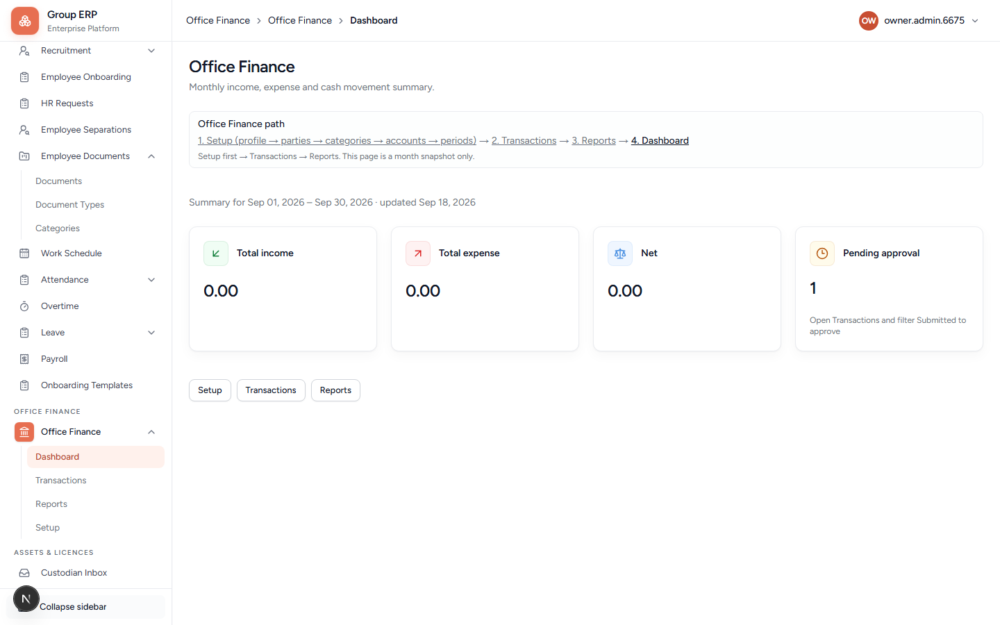
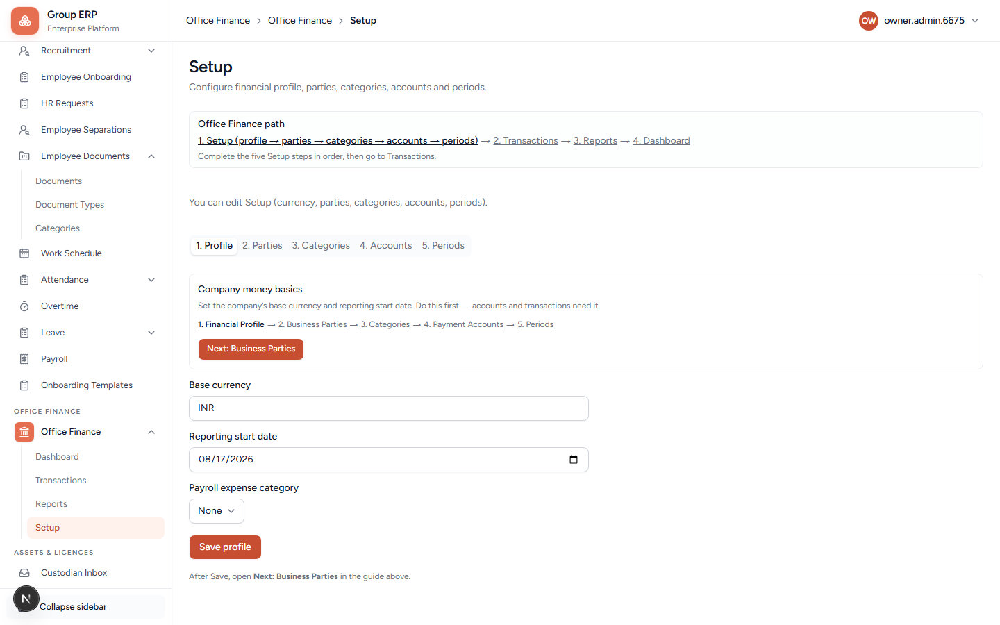
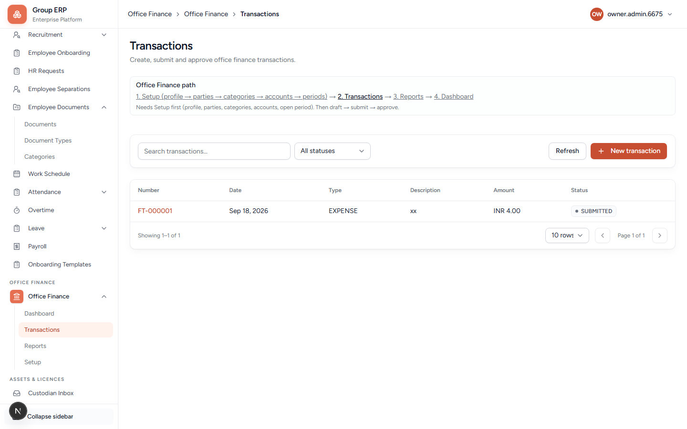
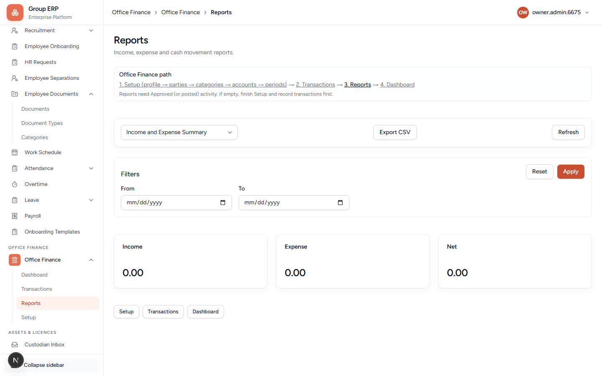

# 14 — Office Finance

**Why this exists:** Lightweight office money notebook: income, expense, transfer — not full statutory accounting.

**Who:** Owner or a finance-capable role.

**Flag:** **Office Finance** menu needs the finance module on.

---

## Order

```text
1. Setup (profile → parties → categories → accounts → periods)
    → 2. Transactions
        → 3. Reports
            → 4. Dashboard
```

### Setup in plain words

| Tab | Needed? | Meaning |
|-----|---------|---------|
| **Profile** | Yes | Currency + first tracking date. **Payroll expense category = optional** (only for later Payroll posting — leave **None** on day one). |
| **Parties** | Recommended | Customer = who pays you. Vendor = who you pay. |
| **Categories** | Yes | Labels such as Office Expense / Service Income. Dropdowns only show what you create here. |
| **Accounts** | Yes | Wallets: Cash (Petty Cash) or Bank. |
| **Periods** | Yes | Open month for posting. Period start cannot be before Profile reporting start date. |

---

## Dashboard

**URL:** `/office-finance`



Month snapshot: **Total income**, **Total expense**, **Net**, **Pending approval**. Jump buttons: Setup, Transactions, Reports.

---

## Setup (do this first)

**URL:** `/office-finance/setup`



Steps along the top: **1. Profile**, **2. Parties**, **3. Categories**, **4. Accounts**, **5. Periods**.

### 1. Profile (Company money basics)

| Field | What it is for |
|-------|----------------|
| **Base currency** | Use the Company's three-letter currency code. Needed before accounts and transactions. |
| **Reporting start date** | First date this company reports from (set on/before the month you open). |
| **Payroll expense category** | Optional. Links Payroll salary posting to an Expense category later. Keep **None** until you need payroll→finance. List only shows Expense categories from step 3. |
| **Save profile** | Writes this step. Then **Next: Parties**. |

---

## Transactions

**URL:** `/office-finance/transactions`



Orange **+ New transaction**. Statuses: DRAFT, SUBMITTED, APPROVED, CANCELLED, REVERSED.

Maker/checker: approve often needs a **different user** than the person who submitted.

Required on a normal Expense: type, date, amount, category, source account, description. Customer/vendor, employee, department, project are optional.

---

## Reports

**URL:** `/office-finance/reports`



Pick a report (default **Income and Expense Summary**), set **From / To**, **Apply**, optional **Export CSV**. Empty totals mean you have not recorded approved activity yet.

Attachments may follow the same **Clean file** rule as employee documents.

This is not bank payment automation and not double-entry GL.

**Pass when:** One expense (or income) can be created and submitted on Northstar.

---

## Next

[15 — Payroll](./15-payroll.md)
