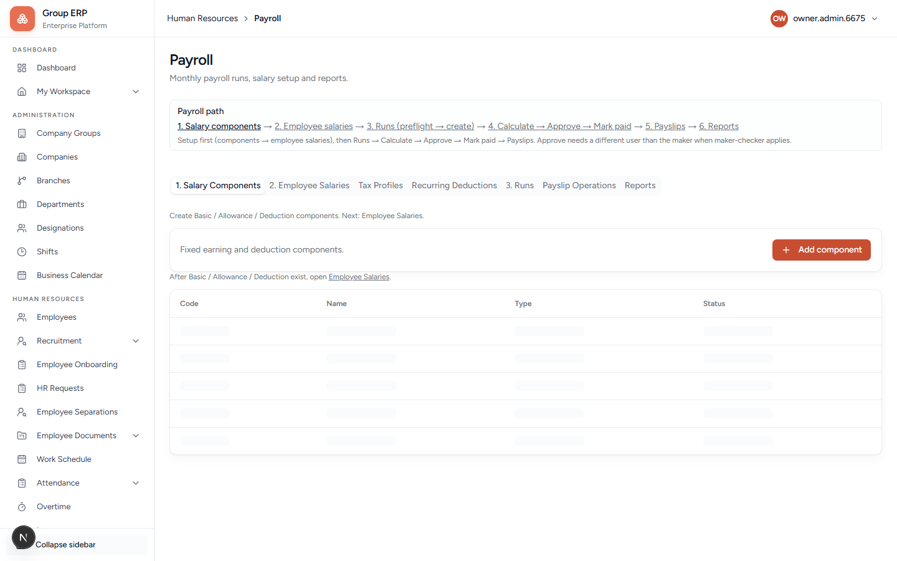

# 15 — Payroll

**Why this exists:** Salary components, employee salaries, a payroll run, payslips. Depends on employees existing and (for a serious run) attendance period health.

**Who:** Arun HR / Owner.

**Menu:** Human Resources → Payroll
**URL:** `/hr/payroll`

**Flag:** Payroll is usually allowed only if Finance is also on, and only for allowlisted companies.

The banner on the page is the real order: **components → employee salaries → Runs → Calculate → Approve → Mark paid → Payslips**. Approve needs a different user than the maker when maker-checker applies.

---

## Tabs

| Tab | What it is for |
|-----|----------------|
| **1. Salary Components** | Earnings / deductions (Basic, HRA, …) — do this first |
| **2. Employee Salaries** | What Rohan is paid |
| **Tax Profiles** | Tax setup used by the run |
| Recurring Deductions | Repeat deductions |
| **Runs** | Create a period run, preflight, calculate |
| **Payslip Operations** | Issue / retry / download payslips |
| **Reports** | Payroll reports |

**Order:** Components → assign salary to Rohan → (optional tax / recurring) → **Run** with preflight → fix blockers → complete run.

Preflight will fail honestly if attendance/payroll-ready data is missing. That is a stop, not a skip.

**Pass when:** A run can be created and preflight explains either success or a clear blocker.

---

## Next

[16 — Operations](./16-operations.md) if you are testing mail/files, else [17 — My Workspace](./17-my-workspace-daily-work.md).
