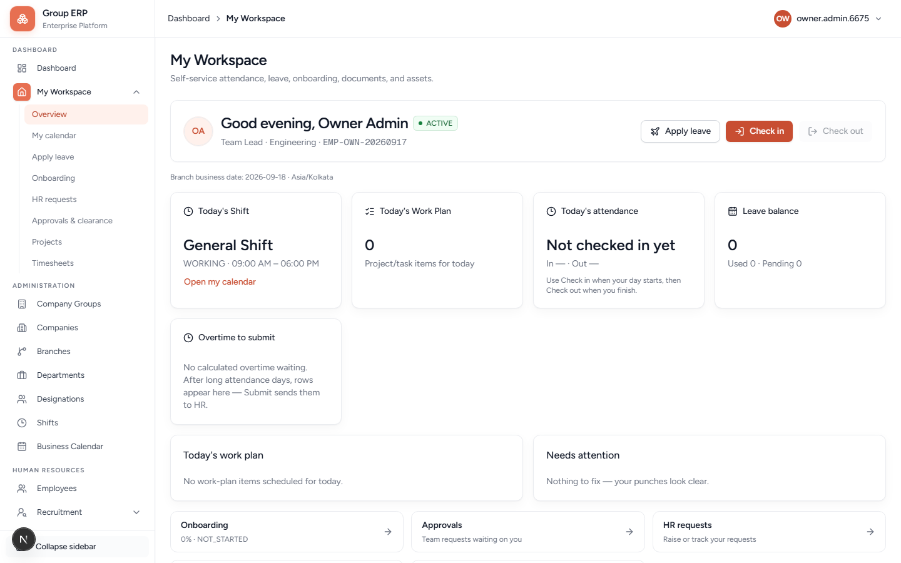
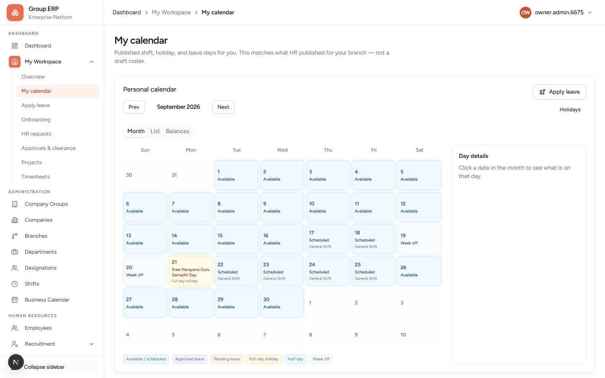
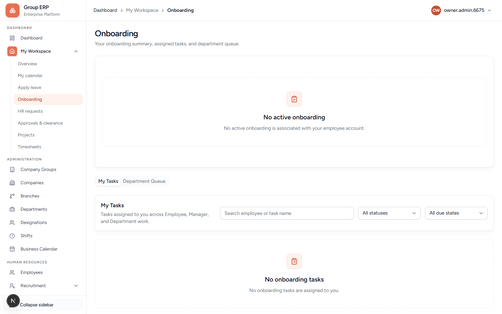
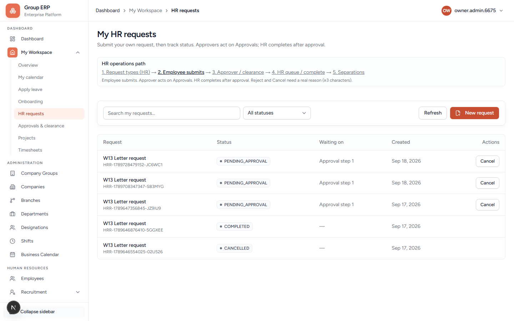
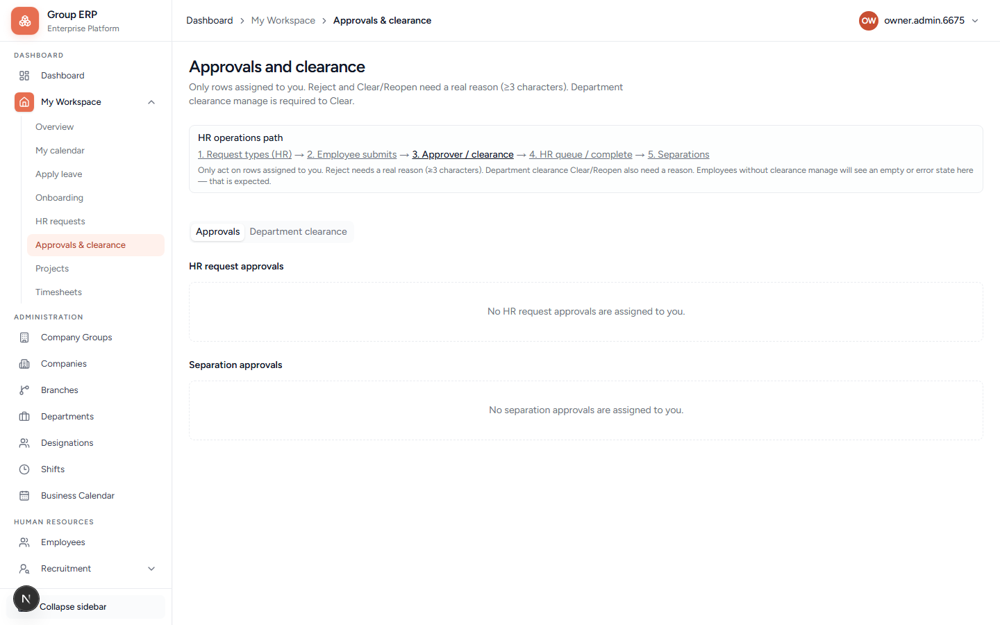
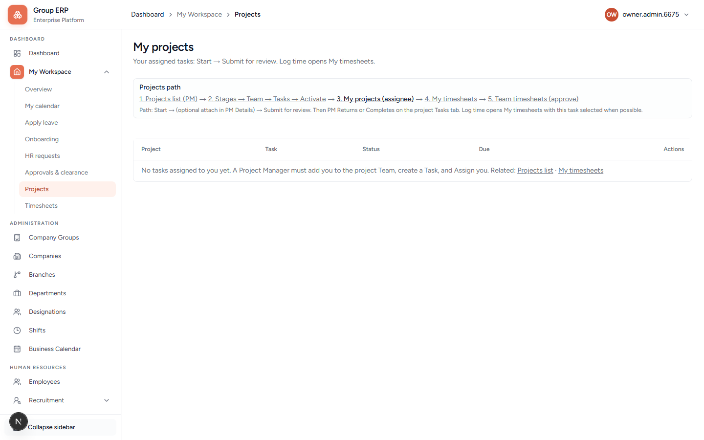

# 17 — My Workspace (daily work)

**Why this exists:** One place for the employee after all masters exist.

**Who:** Rohan Employee (also Meera for approvals).

Owner Dashboard (`/dashboard`) is the admin landing. **My Workspace** is the employee landing. They are different pages.

---

## Overview

**URL:** `/my-workspace`

Identity, punch, widgets. Open **My Workspace → Overview** from the sidebar.

| Control | What it is for |
|---------|----------------|
| **Check in / Check out** | Daily punch (chapter 09). Check out stays disabled until a check-in. |
| **Apply leave** | Prefer **My calendar → Apply leave** if Overview 404s in local Turbopack. Not used for Optional Holiday — use the floating holidays card. |
| **Optional / floating holidays** | Multi-select card when HR published optional dates + annual holiday policy. Save several dates at once. Approval follows the Optional Holiday leave type setting. Locked dates cannot be changed. |
| **Today's Shift** | Published shift (name + hours). |
| **Today's Work Plan** | Project/task items for today. |
| **Today's attendance** | In / Out. If on approved leave today, check-in is blocked with a clear message. |
| **Leave balance** | Used / pending. |
| **Overtime to submit** | Extra hours waiting to send to HR. |
| **Onboarding** | Joining checklist % if HR started an instance. |
| **Approvals** | Inbox for Meera/Arun. |
| **HR requests** | Letters / paperwork (chapter 12). |

---

## Sub-pages

### My calendar — `/my-workspace/calendar`

Working days, holidays, published shifts. After chapter 05 this should not be an empty mystery. **Apply leave** on this page opens the side panel (chapter 10).

### Apply leave

See chapter 10. No Approve button on Rohan’s own request.

### Onboarding — `/my-workspace/onboarding`

Joining tasks only if HR started an instance (chapter 07). Tabs: **My Tasks**, **Department Queue**. Empty state is honest.

### HR requests — `/my-workspace/hr-requests`

Letters / paperwork while employed (chapter 12).

### Approvals & clearance — `/my-workspace/approvals`

Meera/Arun inbox: HR request approvals, separation approvals, department clearance.

### Projects — `/my-workspace/projects`

Assigned project tasks (module flag on).

### Timesheets — `/my-workspace/timesheets`

Submit hours (chapter 13).

---

## What Rohan should check

- Name, company, branch are Northstar / Kochi — not another tenant.
- Calendar makes sense after chapter 05 and 10.
- Apply leave has no Approve on his own request.
- Check in / out appears on a published working day.
- Onboarding list appears only if HR started onboarding.
- **Employee link required** → go back to chapter 03 and link the user.

---

## You finished Track 1 when

- [ ] Organization registered and hub completed
- [ ] Timezone on branch, designations, default shift
- [ ] Three employees + three users linked
- [ ] Calendar published
- [ ] Work schedule published
- [ ] Rohan punched; Arun sees attendance
- [ ] Leave type + matrix (days / year) + balance + Manager → HR approve
- [ ] My Workspace looks honest when empty (says empty / not allowed, not a blank error)

Then optionally run Track 2 (recruitment through payroll) using chapters 06–16.
