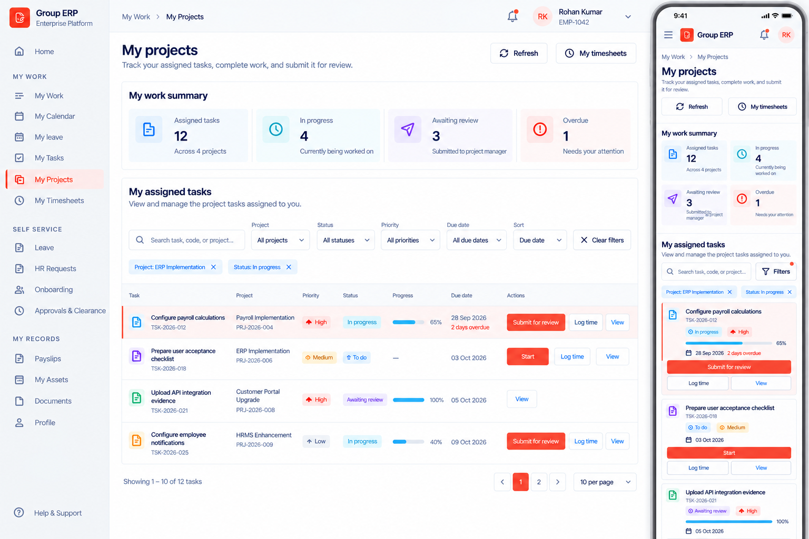
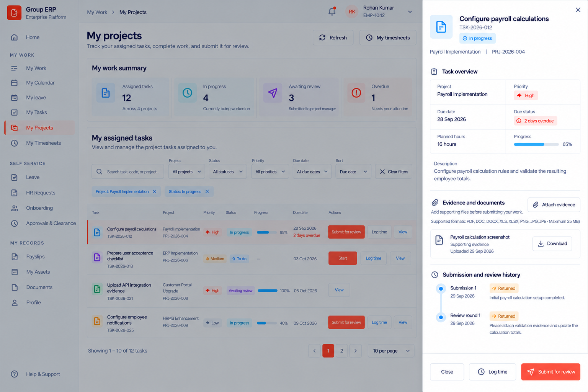
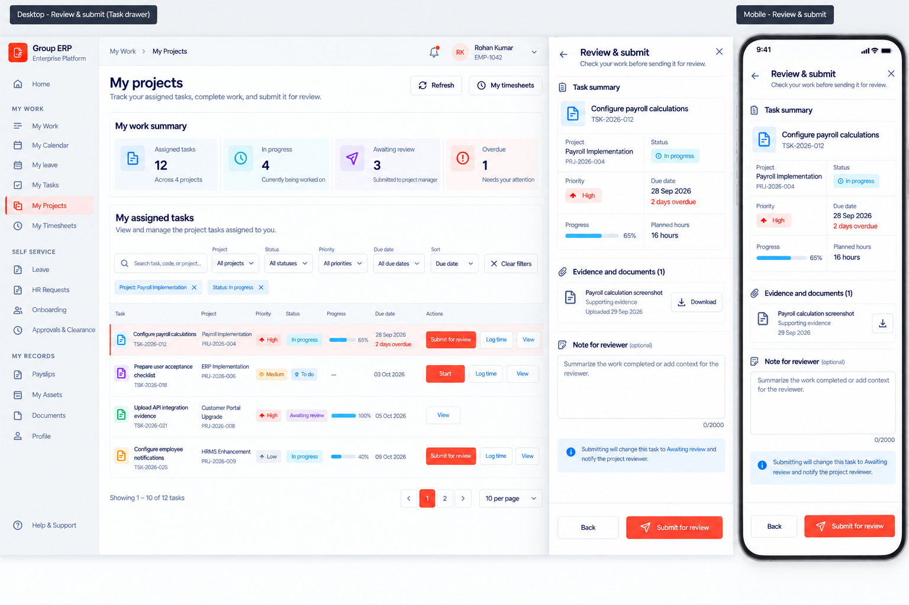

# My Projects Workspace Redesign

## Intent

Redesign `/my-workspace/projects` as a clear employee task workspace while preserving the existing sidebar, application header, route, permissions, project lifecycle, and backend data model. The page must let an employee understand assigned work, filter it, open a task without leaving the page, attach evidence, log time, and submit completed work for review.

The implementation must follow the approved mockups closely, but all content and actions must remain API-backed. The mockup shell is visual reference only; the coded application shell remains unchanged.

## Approved visual references

### Workspace, task table, and responsive cards

Use this image for the page header, connected four-part work summary, compact filter toolbar, desktop task table, mobile task cards, action hierarchy, semantic colors, pagination, and responsive layout.

### Task details drawer

Use this image for the right-side task drawer, task overview, evidence list, submission/review history, and sticky action footer. The desktop drawer is approximately 34rem (544px) wide and becomes full-screen on mobile.

### Review and submit state

Use this image for the in-drawer confirmation state. It replaces the drawer body; it is not a nested dialog, new page, or multi-step wizard.

## Page structure

- Breadcrumb and coded application shell remain unchanged.
- Title: `My projects`.
- Subtitle: `Track your assigned tasks, complete work, and submit it for review.`
- Header actions: `Refresh` and `My timesheets`.
- Remove the internal Projects path banner from this page only.
- Keep the existing `projectsNav` capability gate.

### My work summary

Render one connected summary panel with four semantic sections:

1. Assigned tasks — total active assigned tasks and distinct project count.
2. In progress — tasks whose API status is `IN_PROGRESS`.
3. Awaiting review — tasks whose API status is `WAITING_REVIEW`.
4. Overdue — tasks with a due-date key earlier than the branch business date.

The summary always describes the complete API result, not the filtered page. Desktop uses four columns; mobile uses a 2×2 layout. Use existing design tokens and shared typography rather than copying literal colors from the image.

### Filters

There are no status tabs. Use one compact toolbar containing:

- Search across task name, task code, project name, and project code.
- Project.
- Status: All statuses, To do, In progress, Awaiting review.
- Priority, derived from API values.
- Due date: All dates, Overdue, Today, Next 7 days, No due date.
- Sort: Due date ascending, Due date descending, Priority high-to-low, Project A–Z, Task A–Z.
- A neutral outline `Clear filters` button with an X/reset icon.

Filters combine with AND semantics. Active filters appear as removable chips. Desktop shows the full toolbar. Mobile shows search plus a `Filters` button that opens a full-width filter sheet. Clearing filters also resets sorting, pagination, and active chips.

### Task results

Desktop columns:

- Task and task code.
- Project and project code.
- Priority.
- Status.
- Progress.
- Due date.
- Actions.

Mobile uses cards rather than a horizontally scrolling table. Both presentations use the same filtered and paginated data.

- `OPEN` and `ASSIGNED` display as `To do`.
- `IN_PROGRESS` displays as `In progress`.
- `WAITING_REVIEW` displays as `Awaiting review`.
- Progress remains blue/cyan even when it is 100%; it is not a completion-state color.
- An overdue item receives a thin rose left indicator, a very light rose surface, and rose due-date copy.
- Missing dates, hours, progress, project names, or codes use quiet fallbacks and never display `Invalid Date` or `NaN`.
- Render `Start`, `Submit for review`, and `Log time` only when the API supplies the matching `allowedActions` entry.
- `View` opens the task drawer.
- Do not add bulk selection, status tabs, stage, manager, team, budget, or unsupported overflow menus.
- Paginate the current API result client-side, starting at 10 rows per page.

## Task drawer

Open task details in a right-side Sheet without changing the route. Fetch the authorized self-service detail endpoint only when the drawer opens. Combine project name/code from the selected list item with detail fields from the self endpoint.

Show only API-backed information:

- Task name, code, and status.
- Project name and code.
- Priority, due date and overdue state, planned hours, progress, and description.
- Unique evidence/documents from the task and its submissions.
- Submission and review history using version, dates, decisions, comments, and submission notes.

Do not show raw employee IDs or reviewer IDs. Hide empty optional sections or show the concise approved empty copy. Evidence upload supports PDF, DOC, DOCX, XLS, XLSX, PNG, JPG, and JPEG up to 25 MB. Downloads use the existing short-lived grant flow. Footer actions come only from `allowedActions`.

## Review and submit

Selecting `Submit for review` changes the existing drawer to a focused confirmation state with a Back control. Do not layer another dialog over the Sheet.

Show:

- Compact task, project, status, priority, due date, progress, and planned-hours summary.
- Current evidence count and download rows.
- Optional `Note for reviewer`, maximum 2,000 characters.
- Information copy: `Submitting will change this task to Awaiting review and notify the project reviewer.`

The sticky footer contains `Back` and the brand-primary `Submit for review`. Submission uses the current server version and a fresh operation ID. Prevent duplicate submission. On success, refresh list and detail data, close the drawer, and show `Task submitted for review.` On failure, retain the entered note, show the API error, refresh stale data, and keep the user in context.

## Other actions

- `Start` is a direct allowed action. Disable it while pending, refresh data, and show concise success/error feedback.
- `Log time` navigates to `/my-workspace/timesheets?taskId={taskId}`.
- `Refresh` reloads the task list and the open detail query, shows background progress, and does not clear filters.

## States and accessibility

- Use skeletons for initial summary, filters/results, and drawer loading.
- A list-load failure shows the API message, a Retry action, and no false zero summary.
- A genuine empty list says no assigned project tasks are available.
- A filtered empty result says no tasks match the current filters and offers `Clear filters`.
- Drawer errors stay inside the drawer and provide Retry.
- Controls have visible labels, keyboard focus, and at least 44px touch targets on mobile.
- Opening and closing Sheets restores focus to the invoking control.
- Do not create horizontal page overflow at desktop, tablet, or mobile widths.

## Compatibility constraints

- Preserve `/my-workspace/projects`, sidebar navigation, `projectsNav`, and `PROJECTS_ROUTES`.
- Preserve task lifecycle rules, schemas, migrations, database behavior, and mutation payloads.
- Use the branch business date when available for overdue/today calculations; fall back safely to the current local date only when workspace data is unavailable.
- Keep list filtering and pagination internal because the current self-service API returns at most 100 active assigned tasks.
- Do not add a package or replace shared application components.
- Any evidence-download permission alignment must retain the service-level task-assignee/project-manager check; it must not expose unrelated project documents.

## Acceptance criteria

- The implementation visually follows all three approved references while using shared application tokens and components.
- Summary, filters, sorting, pagination, desktop table, mobile cards, drawer, evidence, history, Start, Log time, and submit-review all use genuine API data and allowed actions.
- No status tabs, Projects path banner, raw IDs, nested submit dialog, unsupported overflow menus, or invented metadata remain.
- Component tests cover behavior and failure states; Playwright covers desktop, tablet, and mobile with no horizontal overflow.
