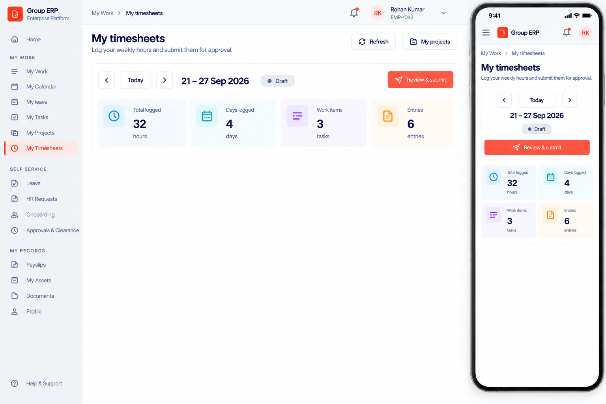
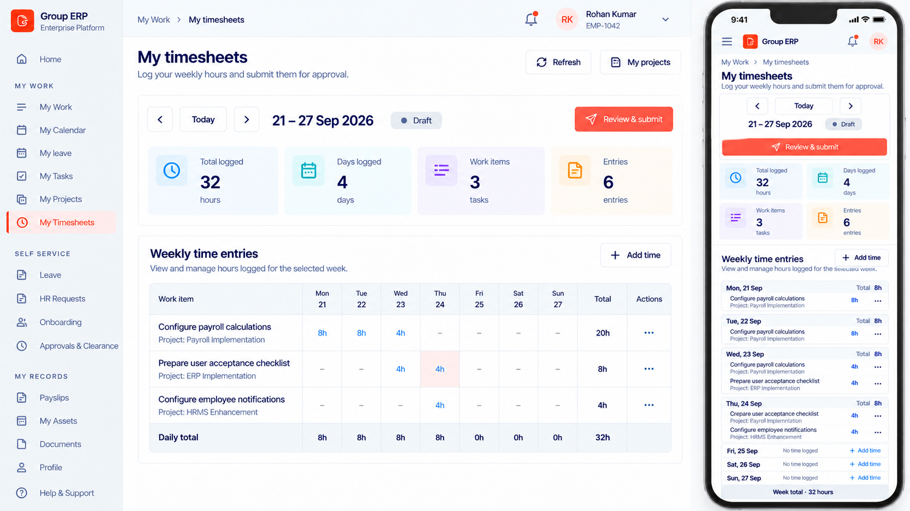
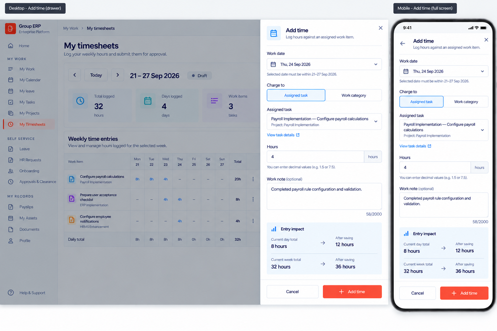
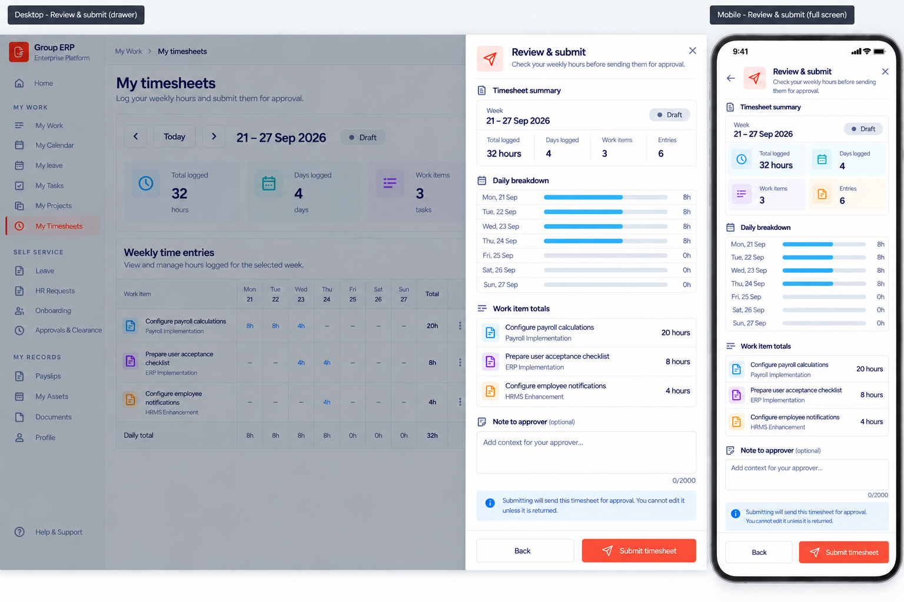

# My Timesheets Redesign Handoff

**Updated:** 04 October 2026

**Branch:** `PMS-170926`

**Starting commit:** `536019b` (`fix: harden employee project task workflow`)

**Current state:** Visual design in progress. No My Timesheets implementation has started.

## Resume Here

Continue with the **Timesheet history** design using the prompt in this document. Do not start implementation until the remaining visual states are approved and the final product specification and implementation plan have been written.

## Product Goal

Redesign `/my-workspace/timesheets` as a proper employee weekly time-entry workspace. The selected week and its entries are the primary surface; history is secondary. The result must follow the approved My Projects visual system at least 95% while preserving existing timesheet workflow rules, routes, permissions, and status transitions.

## Approved UX Decisions

- Use a weekly grid as the main desktop surface.
- Use daily grouped cards on mobile; do not horizontally squeeze the desktop grid.
- Click a day/task cell to add or edit time in a right-side drawer.
- Use a separate Review & submit drawer before submission.
- When a selected week has no timesheet, keep the seven-day workspace visible and offer one **Create timesheet** action.
- Keep Timesheet history below the selected-week workspace.
- Do not use status-wise tabs.
- Do not show expected hours, remaining hours, utilization, a 40-hour target, or an invented work schedule.
- Do not expose task IDs or work-category IDs in the employee UI.
- Desktop drawers are approximately 520–560px wide; mobile drawers become full-screen sheets with fixed footers.
- Preserve the existing sidebar, application header, breadcrumb, route, permission gate, and My Projects deep link.
- Keep the existing date-input approach. Date-picker redesign is outside this work.

## Approved Visual Assets

### 1. Week Navigation and Summary



- Header actions: Refresh and My projects.
- Selected-week controls: previous, Today, next, week range, status, Review & submit.
- Summary: total logged, days logged, work items, and entries.

### 2. Weekly Entry Grid



- Desktop uses one connected grid with thin dividers.
- Mobile uses day groups with task entries and per-day Add time actions.
- Empty weekend cells remain neutral; the UI must not infer week-off status.
- Correct the mobile content inconsistency from the mock: **Prepare user acceptance checklist** belongs to **ERP Implementation**.

### 3. Add Time Drawer



- One-stage form: work date, charge target, assigned task/category, hours, optional note, and entry impact.
- Mobile entry impact uses two stacked before/after rows; never compress four metrics into one row.
- The form accepts decimal hours and shows the current/after-save day and week totals.

### 4. Review & Submit Drawer



- Compact week summary, daily breakdown, work-item totals, optional note, and submission notice.
- No submission-mode choice and no Save as draft option.
- Submission locks employee editing until the manager returns the timesheet.

## Existing Workflow and Rules

The redesign must continue to use the current employee timesheet lifecycle:

`DRAFT -> SUBMITTED -> APPROVED`

`SUBMITTED -> RETURNED -> SUBMITTED`

`DRAFT or RETURNED -> CANCELLED`

- Only `DRAFT` and `RETURNED` timesheets are editable.
- Employee actions are derived from `allowedActions`; never infer permissions from status alone.
- Creating a timesheet uses the company-configured week start. Monday is only the design example.
- The server derives a seven-day inclusive period from the requested week.
- A work date must fall inside the selected timesheet period.
- Each line must charge exactly one assigned task or one active work category.
- A line must be greater than zero and no more than 24 hours.
- The combined total for one employee/date cannot exceed 24 hours.
- A timesheet cannot be submitted without at least one valid line and a positive total.
- Mutations retain operation IDs and expected-version concurrency checks.
- `taskId` supplied through `/my-workspace/timesheets?taskId=...` must continue to prefill the Add time workflow.
- Refresh must reload the list and any open/selected timesheet detail.

## Current Implementation Ground Truth

- Page route: `frontend/app/(dashboard)/my-workspace/timesheets/page.tsx`
- Current workspace: `frontend/features/projects/components/my-timesheets-workspace.tsx`
- Client API: `frontend/features/projects/services/timesheets-api.service.ts`
- Employee controller: `backend/src/modules/projects/project-me-timesheets.controller.ts`
- Backend query/command services live in the Projects module.
- Capability: `projectsNav`
- Permission: `projects.timesheets.submit`
- Existing employee endpoints cover list, detail, create, header update, line add/update/remove, submit, and cancel.

The current UI is a basic history table plus several dialogs. It must be decomposed into focused view-model, selected-week, grid/card, drawer, history, and state components rather than expanding the monolithic workspace.

## Additive Interface Changes Agreed

The employee Timesheet response should expose existing stored workflow metadata so the history and returned states are informative:

- `submittedAt`
- `approvedAt`
- `returnedAt`
- `returnReason`
- `cancelledAt`
- `cancellationReason`

These are additive response fields only. Do not add a database migration or change the public route structure.

Days logged, work-item count, and entry count are derived from the returned lines. The UI must format dates using date-only/calendar-safe helpers and timestamps using the application’s existing timezone conventions.

## Work Category Safety Gap

The approved UI must not ask employees to paste a work-category UUID. The existing generic `/work-category` controller is not an acceptable employee catalog because it is not employee-scoped. Before implementation planning is finalized, choose an authorized employee-scoped catalog contract or explicitly defer category selection while preserving existing task-based entry. Do not silently connect the new UI to the generic global endpoint.

## Remaining Design Queue

Complete and approve these visuals in order:

1. Timesheet history section.
2. Read-only historical-timesheet details drawer.
3. Returned-timesheet state showing the manager’s reason and Fix & resubmit action.
4. Edit/remove time-entry drawer states.
5. No-timesheet/Create timesheet state.
6. Loading, empty, partial-error, stale-version, submitted, approved, cancelled, and read-only states.
7. Final desktop, tablet, and mobile composite review.

## Next Design Prompt: Timesheet History

```text
Extend the approved My Timesheets page by adding a history section below the weekly time-entry grid.

Keep all approved sections unchanged.

SECTION TITLE

Timesheet history

Subtitle:
Review previous weekly timesheets and their approval status.

FILTERS

Create one compact filter row:

- Year: 2026
- Status: All statuses
- Sort: Newest first
- Clear filters — outlined button matching the approved application theme

Do not use status-wise tabs.
Do not add a search field because these are the signed-in employee’s own weekly records.

DESKTOP TABLE

Use one connected bordered table with these columns:

- Week
- Total hours
- Days logged
- Work items
- Submitted on
- Status
- Actions

Show realistic rows:

1. 21–27 Sep 2026 — 32 hours — 4 days — 3 work items — Not submitted — Draft — Continue
2. 14–20 Sep 2026 — 40 hours — 5 days — 4 work items — 21 Sep 2026 — Submitted — View
3. 07–13 Sep 2026 — 38 hours — 5 days — 3 work items — 14 Sep 2026 — Approved — View
4. 31 Aug–06 Sep 2026 — 36 hours — 5 days — 4 work items — 07 Sep 2026 — Returned — Fix & resubmit
5. 24–30 Aug 2026 — 24 hours — 3 days — 2 work items — 31 Aug 2026 — Cancelled — View

STATUS COLORS

- Draft: neutral grey-blue
- Submitted: blue
- Approved: green
- Returned: amber
- Cancelled: muted grey or soft red

Highlight the currently selected week with a very light coral row background and a thin coral indicator on the left. Do not use a full orange border.

ACTIONS

- Continue and Fix & resubmit use compact coral-themed buttons.
- View uses an outlined button.
- Add a three-dot overflow menu only where another valid action exists.
- Do not show Approve or Reject actions.

PAGINATION

- Showing 1–5 of 18 timesheets
- Previous and next buttons
- Page numbers
- 10 per page selector

MOBILE LAYOUT

Replace the table with stacked weekly cards. Each card shows week range, status badge, total hours, days logged, work-item count, submitted date, and its valid action. Keep the selected week highlighted with a subtle coral left indicator. Do not use horizontal scrolling.

Maintain the approved Group ERP typography, spacing, borders, button styles, and status badges. Keep history visually secondary to the selected-week workspace. Do not add summary cards, charts, approval timelines, status tabs, or internal IDs. Show the complete desktop and mobile responsive pages together. Do not design the historical-timesheet details drawer yet.
```

## Final Specification and Implementation Plan

After the remaining designs are approved, create:

- `docs/superpowers/specs/2026-10-04-my-timesheets-workspace-redesign.md`
- `docs/superpowers/plans/2026-10-04-my-timesheets-workspace-redesign.md`

The final implementation plan must cover:

- Range-aware list/detail data loading and selected-week state.
- Week navigation using server-normalized periods.
- Derived weekly grid and mobile day groups without losing individual line identity.
- Add/edit/remove line drawers and concurrency refresh behavior.
- Review note update followed by submission using the latest returned version.
- History filtering, pagination, returned reason, and read-only detail drawer.
- Permission-safe actions and API-provided `allowedActions`.
- Desktop, tablet, and mobile states.
- Unit, component, backend contract, responsive Playwright, typecheck, lint, test, and production-build verification under Node 24.20.

## Copy-Paste Resume Prompt

```text
Work on branch PMS-170926. Read docs/superpowers/specs/2026-10-04-my-timesheets-redesign-handoff.md and inspect every approved asset in docs/superpowers/specs/assets/my-timesheets/. Continue the My Timesheets UI design from the Timesheet history prompt in the handoff. Preserve the approved Group ERP/My Projects visual system, current route, permissions, status lifecycle, concurrency rules, and responsive behavior. Do not implement code until all remaining visual states, the final specification, and the implementation plan are approved. Do not use temporary image paths, expose internal IDs, connect the employee UI to the generic global work-category endpoint, or include credentials in documentation.
```

## Transfer Checklist

- Commit this handoff and the approved image assets on `PMS-170926`.
- Push the branch to the shared remote before changing computers.
- On the other PC, fetch and checkout `PMS-170926`.
- Use Node 24.20 for implementation verification.
- Confirm the four approved image assets render from the repository.
- Start the next session with the copy-paste resume prompt above.
- Never commit login credentials, `.env` secrets, or real employee data.
